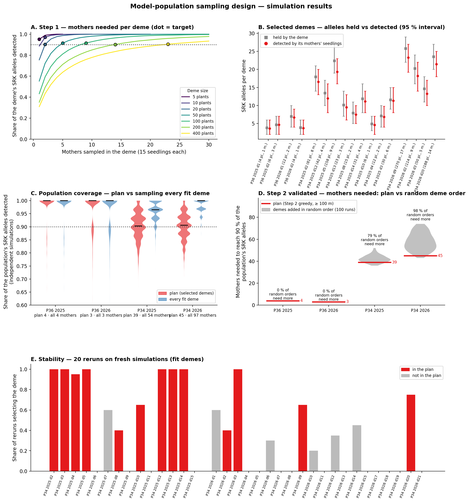
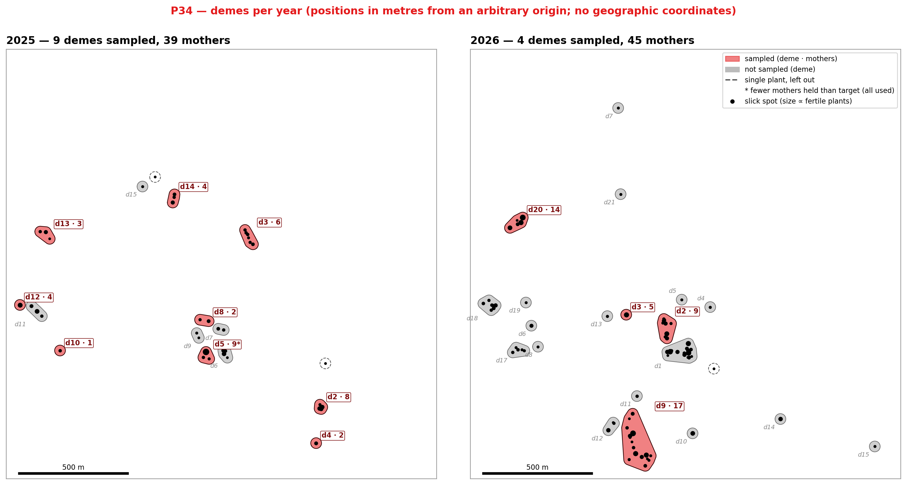
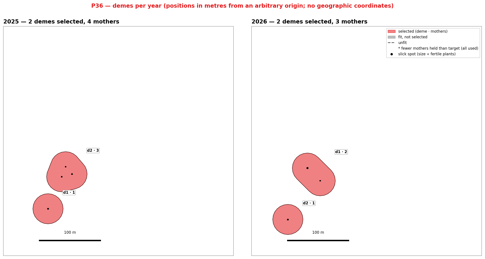
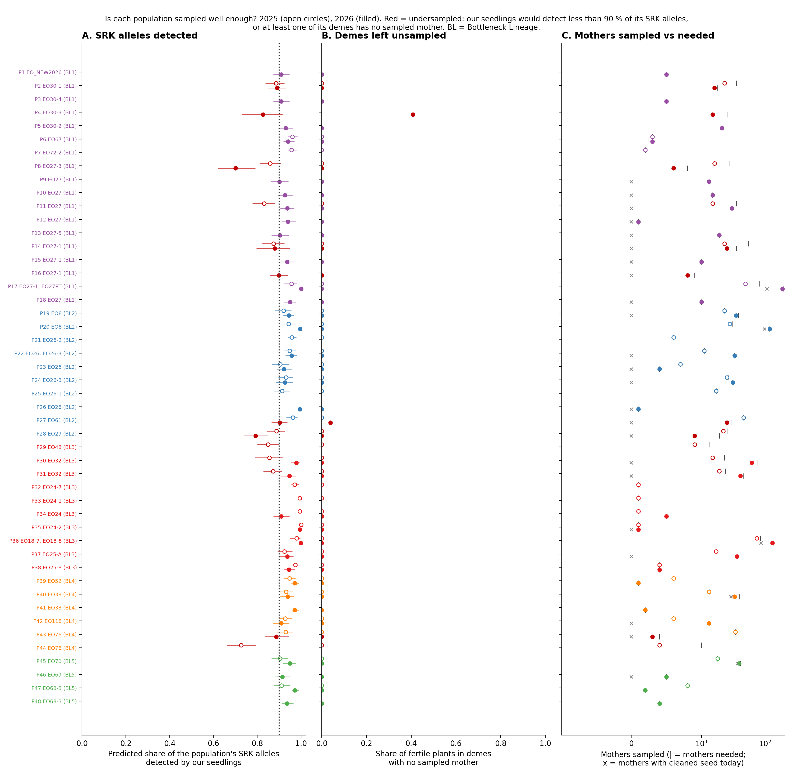

# Sampling design — SRK diversity of the D1 model populations

**What this document is.** The sampling plan agreed for measuring **SRK
allele diversity** in the two D1 model populations, by genotyping
seedlings and their mothers: the reasoning behind it, the simulations
that support it, and the files the lab team works from. Sampling to
measure pollen compatibility (mate limitation) is a separate step that
will be designed next (§ 6). The wider project — populations, Bottleneck
Lineages, predictions and the seed-yield test — is described in
[`Project_outline.md`](Project_outline.md). An earlier, more detailed
version of this document (design alternatives, model history) is kept,
no longer maintained, in
[`archive/Sampling_design_detailed.md`](archive/Sampling_design_detailed.md).

**For the lab team:** the list of mothers to germinate is
**[`tables/step30_D_model_design_lab_sheet.tsv`](tables/step30_D_model_design_lab_sheet.tsv)**
(§ 5).

---

## 1. Why we measure SRK diversity in D1

LEPA can only mate with plants carrying different SRK
(self-incompatibility) alleles, so the number of SRK alleles a
population still holds sets how many mates each plant can find. How
much SRK diversity populations have kept is therefore the first thing
to know.

The genotypes we already have show that it is far less than expected:
at five of the six genotyped sites we find 5 – 9 alleles where the
project's model, which assumes each population is a random sample of the
species, predicts 22 – 29. To understand how much diversity is left, and
how it depends on population size, we need to measure it in populations
of very different size that share the same history.

**D1** is that pair, both in Bottleneck Lineage 3 (BL3):

| Role | Population | Fertile plants (2025 / 2026) | Demes (2025 / 2026) |
|---|---|:-:|:-:|
| Small | **P36** (EO25-B) | 10 / 16 | 2 / 2 |
| Big | **P34** (EO18-7 + EO18-8) | 523 / 1 150 | 16 / 21 |

A **deme** is a group of slick spots within 50 m of each other, close
enough to share pollinators; it is the unit within which plants mate.

**Goal.** For each population and each season (2025 and 2026 seed),
recover **90 % of the population's SRK alleles** while sampling as few
mothers as possible and covering the population across its extent.

**Why seedlings.** A seedling carries 2 SRK alleles from its mother and 2
from its father, a plant of the mother's deme. Genotyping a mother's
seedlings therefore reveals her own alleles and also alleles of the
plants around her, so each mother samples several plants of her deme.

---

## 2. How the plan works

**Per mother: 25 seeds germinated → about 15 seedlings genotyped.**
Seeds germinate at about 60 %; 15 seedlings per mother capture most of
the SRK alleles among the fathers around her, and more add little.

**Step 1 — how many mothers each deme needs.** Large demes hold more
alleles, including rare ones, so they need more mothers. The number is
set by simulation: each deme is simulated plant by plant — tetraploid
plants (4 SRK copies, most plants carrying a single allele in all four,
as observed in LEPA), alleles drawn from the species-wide frequencies,
and fathers that must be compatible with the mother under LEPA's
self-incompatibility system. The target is the smallest number of
mothers whose seedlings recover, on average, 90 % of the deme's alleles:

| Fertile plants in the deme | 2 – 5 | 10 – 20 | 50 | 100 | 200 | 400 |
|---|:-:|:-:|:-:|:-:|:-:|:-:|
| Mothers needed | 1 | 2 | 5 | 9 | 14 | 23 |

On top of that, every slick spot of a sampled deme gets at least one
mother. A deme with a single fertile plant is left out (it has no mate
in its deme).

**Step 2 — which demes to sample.** Sampling every deme would cost 158
mothers. Instead, demes **at least 100 m apart** are added one at a
time, the one adding the most new alleles per mother first, until the
selected demes are expected to recover **90 % of the whole population's
SRK alleles**. The search is repeated from every possible starting deme
and the plan needing the fewest mothers is kept. The 100 m spacing makes
the selected demes separate pollen pools and spreads the sample across
the population. In the small P36, both demes are taken.

**Which mothers within a deme — at random.** Mothers are drawn at random
among those whose cleaned seed lot holds at least 25 seeds (one per slick
spot first, then the rest of the deme's number). We deliberately do
**not** pick the mothers with the most seed: a mother sets much seed
when she finds many compatible mates, so choosing on seed would favour
some allele combinations over others and misrepresent the population's
SRK diversity. The draw is reproducible (fixed random seed per population,
year and deme).

**One adjustment in 2025.** P34's largest 2025 deme (158 plants) holds
9 sampled mothers where Step 1 asks for 12. Leaving it out would leave a
third of the population unrepresented and the plan short of 90 %, so it
is included with all 9 of its mothers. Its own allele estimate is
therefore a little less precise than the other demes'. 2026 needs no
adjustment.

---

## 3. Does the plan work? — simulations

The plan was tested on simulated populations built from the real deme
sizes of P34 and P36 ([Figure 1](#fig-1)):

- **Each selected deme recovers most of its alleles** (Figure 1 B): the
  alleles its mothers' seedlings reveal (red) sit close to the alleles
  the deme holds (grey).
- **Each population reaches the 90 % goal** (Figure 1 C), as judged on
  simulations not used to choose the demes: 98.5 % and 96.3 % for P36,
  90.5 % and 90.3 % for P34 (2025, 2026). Sampling every deme would reach
  96 – 98 % at almost twice the cost.
- **The deme selection beats chance** (Figure 1 D): adding demes in a
  random order until 90 % is reached takes a median of 42 mothers in
  P34 2025 (the plan: 39) and 57 in P34 2026 (the plan: 45).
- **The selection is stable** (Figure 1 E): rerun on fresh simulations,
  most selected demes are chosen every time. In P34 2026 a few
  near-equivalent plans exist; all reach the goal, and the plan is
  fixed so the lab list does not change.

**Figure 1.** Simulations behind the D1 plan. **A** — share of a deme's SRK alleles recovered against the number of mothers (15 seedlings each), one curve per deme size; dot = the number of mothers used; dotted line = 90 %. **B** — for each selected deme, SRK alleles it holds (grey) and alleles its mothers' seedlings recover (red), mean and 95 % interval; labels give plants (pl.) and mothers (m.). **C** — share of the population's SRK alleles recovered by the plan (red) and by sampling every deme (blue), over independent simulations; bar = median. **D** — mothers needed to reach 90 % when demes are added in random order (grey) against the plan (red line). **E** — how often each deme is selected when the plan is rerun on 20 fresh simulations; red = in the plan.

---

## 4. The D1 plan

| Population | Season | Demes sampled (of usable) | Mothers | Seeds to germinate → seedlings | SRK alleles recovered (expected) |
|---|:-:|:-:|:-:|:-:|:-:|
| P36 (small) | 2025 | 2 of 2 | 4 | 100 → ~60 | 98.5 % |
| | 2026 | 2 of 2 | 3 | 75 → ~45 | 96.3 % |
| P34 (big) | 2025 | 9 of 14 | 39 | 975 → ~585 | 90.5 % |
| | 2026 | 4 of 20 | 45 | 1 110 → ~666 | 90.3 % |
| **Total** | | | **91** | **2 260 → ~1 356** | |

- **Selected demes** (deme · mothers). P34 2025: 2 · 8, 3 · 6, 4 · 2,
  5 · 9 (the adjusted deme), 8 · 2, 10 · 1, 12 · 4, 13 · 3, 14 · 4.
  P34 2026: 2 · 9, 3 · 5, 9 · 17, 20 · 14. P36: demes 1 and 2 in both
  seasons.
- The selected demes hold 76 % (2025) and 54 % (2026) of P34's fertile
  plants and span the population from north-west to south
  ([Figure 2](#fig-2)).
- **All 91 mothers have cleaned seed ready to germinate.** One P34 2026
  lot holds 10 seeds and is germinated in full.

**Figure 2.** P34 demes, 2025 (left) and 2026 (right). Coloured = sampled (label: deme · mothers; * = the 2025 deme sampled with fewer mothers than its target); grey = not sampled; dashed = a single-plant deme, left out. Black dots = slick spots, sized by fertile plants. Positions are in metres from an arbitrary origin, north up; the map carries no geographic coordinates.

**Figure 3.** P36 demes, 2025 (left) and 2026 (right); same conventions as Figure 2. Both demes are sampled in both seasons.

---

## 5. For the lab — the files

**The lab sheet** —
**[`tables/step30_D_model_design_lab_sheet.tsv`](tables/step30_D_model_design_lab_sheet.tsv)**
— one row per mother (91 rows), sorted by BL, population, season, deme
and slick spot. It is keyed on **occurrenceID** (the wild mother), so it
works even where a germplasmID is still missing.

| Column | Meaning |
|---|---|
| `occurrenceID` | The wild mother plant — the key for the lab |
| `germplasmID` | Her cleaned seed lot |
| `BL`, `population`, `EO`, `locationCode` | Where she grows |
| `year` | Season the seed was collected (2025 or 2026) |
| `demeID`, `eventID_slick_spot` | Her deme and slick spot |
| `pair`, `role` | D1, small (P36) or big (P34) |
| `status` | `germinate` — the seed lot is ready |
| `seeds_available` | Seeds in the lot |
| `seeds_to_germinate` | 25, or the whole lot if smaller |
| `seedlings_expected` | Seedlings to genotype (about 15) |
| `selected_because` | How she was drawn (one per slick spot, or among the deme's other mothers) |

**What to do per mother:** germinate `seeds_to_germinate` seeds, then
genotype the seedlings (about 15) and record each seedling against the
mother's occurrenceID and germplasmID, so seedlings can be grouped by
mother and deme.

**Other files.**
- [`tables/step30_D_model_design_germplasm_by_deme.csv`](tables/step30_D_model_design_germplasm_by_deme.csv)
  — the same mothers listed by germplasmID, deme by deme (for pulling
  seed lots).
- [`tables/step30_D_model_design_demes.tsv`](tables/step30_D_model_design_demes.tsv)
  — every deme of P34 and P36: plants, mothers needed and held, whether
  it is sampled.
- [`tables/step30_D_model_design_summary.tsv`](tables/step30_D_model_design_summary.tsv)
  — the totals of § 4.

The plan is produced by `Scripts/step28_model_population_design.py`
(`./run_pipeline.sh design`); rerunning it gives the same lists.

---

## 6. Beyond D1, and what comes next

**Other populations.** With the mothers already collected, 27 of 33
populations (2025) and 32 of 37 (2026) hold enough mothers in every deme
for their seedlings to recover 90 % of their SRK alleles
([Figure 4](#fig-4)); the others need more mothers before their SRK
diversity can be measured this way.

**Figure 4.** Can each population's SRK diversity be measured with the mothers already collected? One row per population, grouped by Bottleneck Lineage; open circle = 2025, filled = 2026; red = not yet. **A** — expected share of the population's SRK alleles its collected mothers' seedlings would recover (dotted line = 90 %). **B** — share of fertile plants in demes with no collected mother. **C** — mothers collected (circle), mothers needed (|) and mothers with cleaned seed so far (×). Data: [`step30_A_sampling_adequacy_2025.tsv`](tables/step30_A_sampling_adequacy_2025.tsv), [`_2026`](tables/step30_A_sampling_adequacy_2026.tsv).

**Next: sampling for pollen compatibility.** The D1 genotypes will also
let us check the project's predictions of pollen compatibility — how
many plants each plant can mate with — at P34 and P36. Testing whether
plants with fewer compatible mates set less seed (mate limitation) is a
different question with different needs: a first simulation suggests it
takes many more mothers than D1, drawn across populations
([`figures/step23_power.png`](figures/step23_power.png)). That sampling
will be designed as a separate step, building on the SRK diversity
measured here.

**Assumptions to keep in mind.** The simulations treat each deme as an
independent draw from the species-wide allele frequencies. Real demes
have drifted further and neighbouring demes share alleles, so the real
populations probably hold fewer alleles than simulated — which makes the
90 % goal easier, not harder, to reach. Measuring how many they really
hold is what D1 is for.
