# Towards prioritising slickspot peppergrass populations for seed production

**What this document is.** The companion to the NCA Symposium talk
(15 minutes) and the source of its figures: which *Lepidium
papilliferum* populations meet the reproductive requirements for **seed
bulking**, based on field data (seed set for plant size) and the genetic
framework of [`Project_outline.md`](Project_outline.md). All figures are
in [`figures_seed_bulking/`](figures_seed_bulking/); the population table is
[`tables/step32_seed_bulking_populations.tsv`](tables/step32_seed_bulking_populations.tsv).

> **Main result.** Of 44 populations, only **3 are reproductively intact
> over two seasons** and qualify as sources for seed bulking — **P34**
> (EO18) and **P35** (EO25-A) in BL3, and **P43** (EO68-3) in BL5 — and
> they cover only two of the five lineages. Eight more look intact but
> have a single season of data, so a second season could add sources,
> including the first for BL1 and BL4 (§ 6, § 8). All three still need the
> genetic filters (SRK diversity, no self-compatible plants) before
> bulking.

**Colours used throughout the talk.** Each population's reproductive
type has one colour on every figure and map, distinct from the
Bottleneck Lineage (BL) colours, which appear on maps as dashed outlines:

| Type | Colour | Meaning |
|---|---|---|
| **Mate-limited** | magenta `#C2185B` | sets less seed than its plants' size predicts (hollow = candidate) |
| **Reproductively intact** | teal `#00897B` | sets the seed its plants' size predicts |
| **Over-producing** | gold `#E6A100` | sets more seed than its size predicts — a possible sign of self-fertilisation (SI escape) |
| Not yet clear | grey `#9E9E9E` | switches between seasons |
| One season only | light grey `#D9D9D9` | seed data in a single season — more data required |

*Authors:* Sven Buerki, Peggy Martinez, Mathew Geisler, Sam Billingsley,
Isaac Carretero, Kylie Stear, Alex Scott, Jayden Yun, Elizabeth Berrier,
Ashley Zahurak & Ian Robertson.

---

## 1. Why seed bulking

Slickspot peppergrass is federally threatened and its seeds are a limited
resource. Seed bulking — collecting a small number of seeds from a target
population and growing them in a greenhouse to harvest a much larger
quantity — will supply a genetically informed breeding programme that
supports population restoration through seed translocation. The source
populations for bulking must meet specific reproductive and genetic
requirements; this document identifies them from field and genetic data.

---

## 2. What we know so far

Populations decline independently of habitat quality, which points to a
biological limit on reproduction. Our research shows that:

- **Populations cluster into two genetic groups**, Snake River Plain (SRP)
  and Jarbidge (JAR); this work covers SRP.
- **The landscape is heavily fragmented** — five fragments, the
  Bottleneck Lineages, across SRP (Figures 1, 2 and 4).
- **The species is self-incompatible (SI)**, a trait under genetic
  control (the SRK gene): a plant can only be fertilised by a mate
  carrying different SRK alleles.
- **Some populations have escaped SI** and become self-compatible.
- **Populations have declined significantly** over the last 15 years.

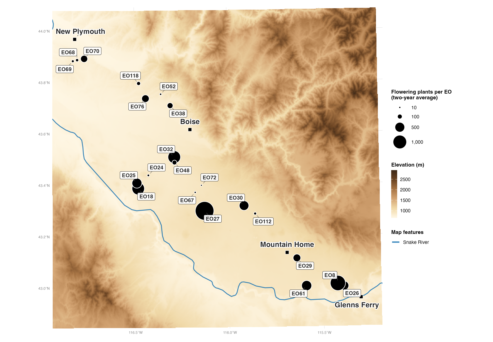

**Figure 1.** The element occurrences (EOs) sampled across the Snake River Plain, sized by flowering plants (two-year average).

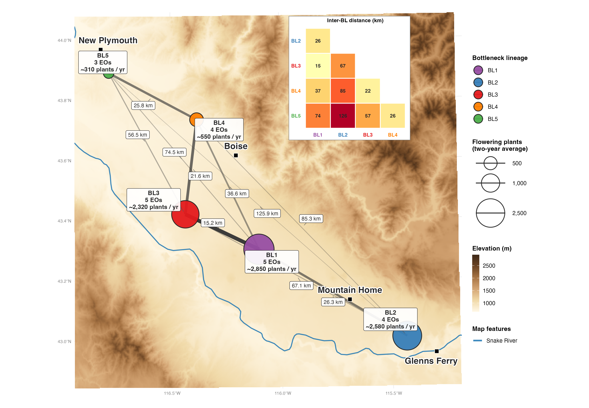

**Figure 2.** The five fragments (Bottleneck Lineages), with the shortest distance between them.

**How populations are defined.** Every result that follows is reported
per **population**, so the unit matters. A population groups the slick
spots of all seasons (so far 2025 and 2026) that lie within 500 m of each other — far enough
apart from the next population that pollen and seed rarely move between
them. Inside a population, the slick spots of one season that lie within
50 m of each other share pollinators and form a **deme**, the group of
plants that actually mate with each other ([Figure 3](#fig-3)). Seed
bulking draws its source seed from whole populations; deciding which
population is a source therefore rests on this definition.

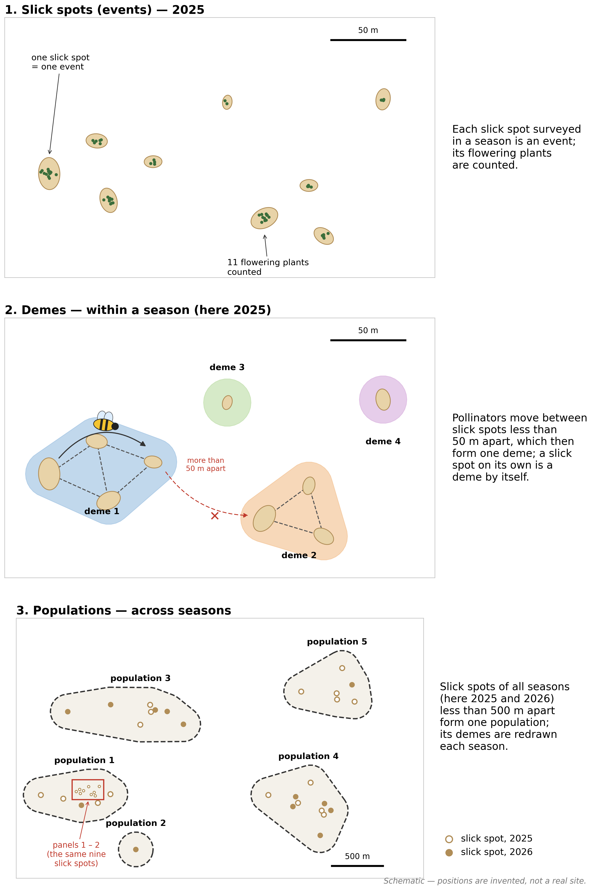

**Figure 3.** Slick spot (event) → deme → population. **1** — each slick spot surveyed in a season is an event, and its flowering plants are counted. **2** — within a season, pollinators move between slick spots less than 50 m apart, which then form one deme; a slick spot on its own is a deme by itself. **3** — slick spots of all seasons (here 2025 and 2026) less than 500 m apart form one population, inside which demes are redrawn each season; the red box marks where the close-up of panels 1 – 2 lies. Positions are invented. Source: `Scripts/units_cartoon.py`.

**Populations by lineage.** Applying this definition to every slick spot
surveyed in 2025 and 2026 gives **44 populations** in 21 EOs across the five
Bottleneck Lineages ([Figure 4](#fig-4)):

| Lineage | EOs | Populations | Present in both seasons |
|---|:-:|:-:|:-:|
| BL1 | 5 | 17 | 6 |
| BL2 | 4 | 9 | 7 |
| BL3 | 5 | 10 | 7 |
| BL4 | 4 | 5 | 4 |
| BL5 | 3 | 3 | 2 |
| **Total** | **21** | **44** | **26** |

BL1 holds the most populations but the smallest share present in both
seasons (6 of 17); across all lineages, 18 populations were above ground in
only one of the two seasons.

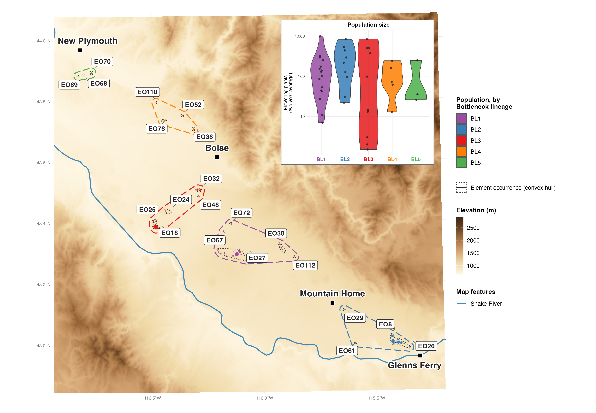

**Figure 4.** Every population at its real extent, coloured by BL, with EO outlines; inset: population size per BL. The EO map coloured by BL is [`EO_sampling_map_BL.png`](figures_seed_bulking/EO_sampling_map_BL.png); the fine-scale maps, one per BL, are kept locally (`./run_pipeline.sh talkmaps`).

---

## 3. Reproductive status of every population — seed set for plant size

**Approach.** Every plant whose seeds were collected is photographed
against a whiteboard with rulers to measure its crown and height
([Figure 5](#fig-5)), and its seeds are counted. Larger plants set more
seed. Across all **1 509 plants
measured in 2025 and 2026**, seed count rises with crown size along one
curve shared by all populations, so each plant has an expected seed set
for its size ([Figure 6](#fig-6)). A population whose plants set,
on average, significantly less seed than their size predicts is
**mate-limited**; significantly more, **over-producing**; neither,
**reproductively intact**.

**Only populations with two seasons of data are typed.** All plants
shape the curve, but a population is typed only if at least 3 of its
plants were measured in **both** 2025 and 2026, so that no call rests on
a single good or bad season. Seed set was 15 % lower in 2026 across
populations; the types allow for that shared drop. **12 populations**
qualify; the other **25 have one season of data and need more before
they can be typed** — they stay on every figure in light grey.

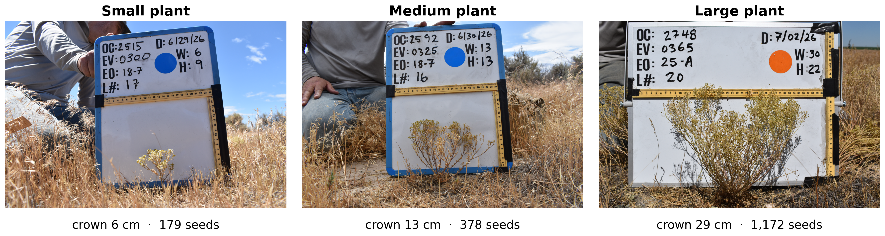

**Figure 5.** Plant size phenotyping in the field, 2026: a small, a medium and a large plant photographed against the measuring board (crown width and height on the rulers), with their crown size. All three set about the seed their size predicts. Photos with location metadata removed: `figures_seed_bulking/plant_photos/`.

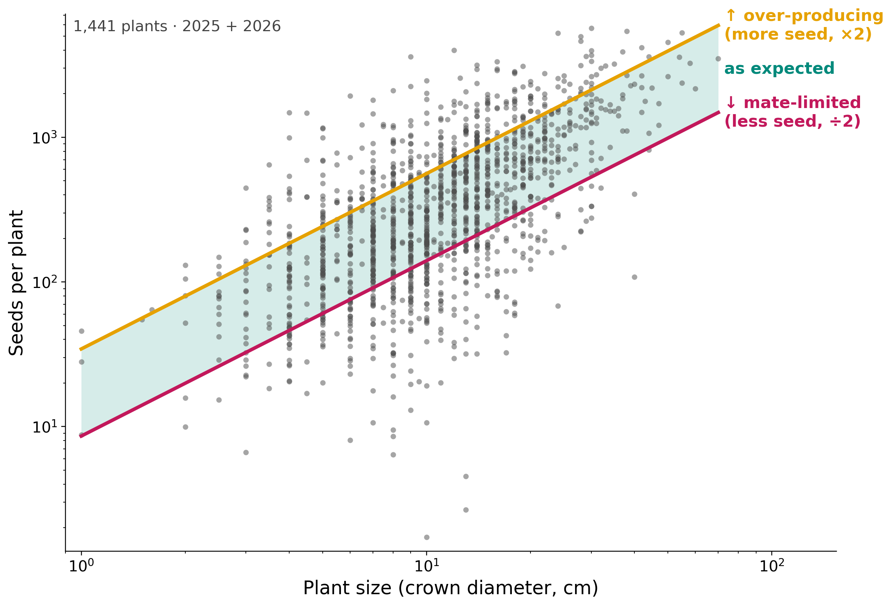

**Figure 6.** Seeds per plant against plant size (crown diameter), 1 509 plants, both seasons; log scales. Teal band = as expected, between half (magenta line) and twice (gold line) the seed a plant of that size is expected to set — the colours of the three reproductive types used in the rest of the talk.

**Result — the 12 two-season populations.**

| Type | Populations (BL) |
|---|---|
| **Mate-limited** | P10 EO27-3 (BL1), P16 EO27-1 + EO27RT (BL1), P42 EO70 (BL5); candidates P6 EO67 (BL1), P13 EO27-1 (BL1), P36 EO25-B (BL3) |
| **Reproductively intact** | **P34** EO18-7 + EO18-8 (BL3), **P35** EO25-A (BL3), **P43** EO68-3 (BL5) |
| **Over-producing** | P2 EO30-1 (BL1), P37 EO38 (BL4) |
| Not yet clear | P19 EO8 (BL2) — significantly above expectation in 2025, below in 2026 |

Among the one-season populations, four show a strong seed shortfall
(P1 EO112, P4 EO30-3, P8 EO27, P32 EO24) and should be measured again
before they are typed.

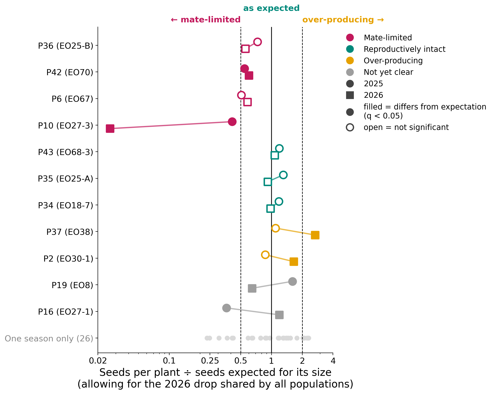

**Figure 7.** Seed set relative to what plant size predicts, per population and season, allowing for the 2026 drop shared by all populations; 1 = as expected, dashed lines = half and twice. Circle = 2025, square = 2026; **filled = that season differs significantly from expectation** (false-discovery-corrected q < 0.05), open = not significant. P10 and P42 are significantly below expectation in both seasons and P16 in 2025; P2 and P37 significantly above in 2026 only; P6, P13 and P36 (candidates) and the three intact populations are not significant in either season; P19 is significant in opposite directions. Bottom row: the 25 one-season populations.

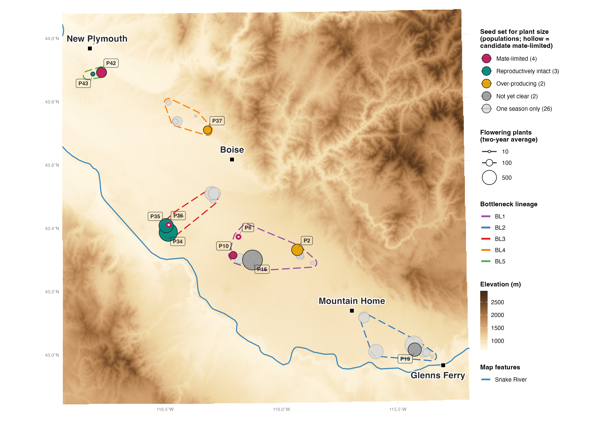

**Figure 8.** Reproductive type of every population on the Snake River Plain, sized by flowering plants; dashed outlines = Bottleneck Lineages.

---

## 4. What seed set cannot tell us on its own

Seed set for plant size is a powerful first screen — it covers every
population, needs no lab work and flags where reproduction falls short.
But **seed yield also depends on resources**: water and soil conditions
in the slick spots, the weather of the season, herbivory, pollinator
visits and the condition of each plant. Our test already allows for
plant size (which partly reflects resources) and for the drop in 2026
shared by all populations, but not for conditions that differ from site
to site. A population on a dry site could set less seed for its size
without any shortage of mates; a well-watered one could hide a mild
shortage.

The seed-yield types are therefore **hypotheses about reproduction**.
To confirm that a population is mate-limited — that its plants lack
compatible mates — we need its **SRK genotypes**: a mate-limited
population should hold fewer SRK alleles, or alleles so unevenly shared
that each plant can mate with only part of the population.

---

## 5. A genetic example — P42 against P34

Two of the typed populations already have SRK genotypes: **P42**
(EO70), mate-limited in both seasons, and **P34** (EO18), reproductively
intact in both seasons ([Figure 9](#fig-9)).

- **Seed set (A).** P42 sets about half the seed its plants' size
  predicts in both seasons; P34 sets the expected amount.
- **SRK alleles (B).** P42's plants carry 6 SRK alleles, and two of them
  make up 97 % of all copies. P34's carry 7, more evenly shared: the two
  commonest make up 69 %.
- **Mates available (C).** Because most of P42's plants carry the same
  two alleles, a plant can mate, on average, with **53 %** of its
  population; in P34, with **67 %**. The two ranges do not overlap
  (P42 0.51 – 0.56, P34 0.61 – 0.72).

The genetics point to the same answer as seed set for plant size: **P42 is short
of compatible mates, P34 is not** — although P34's 67 % is itself below
the 78 % expected if its alleles were a random sample of the species, so
it too has lost diversity, just not enough to depress its seed set. This
is one pair — an example, not a
test across populations. P42's genotyped plants are mostly seedlings
from 10 wild mothers and P34's are 32 plants, and siblings are not yet
corrected for. The SRK genotyping of P34 planned for 2025 – 2026 seed
([`Sampling_design.md`](Sampling_design.md)) will extend this
comparison.

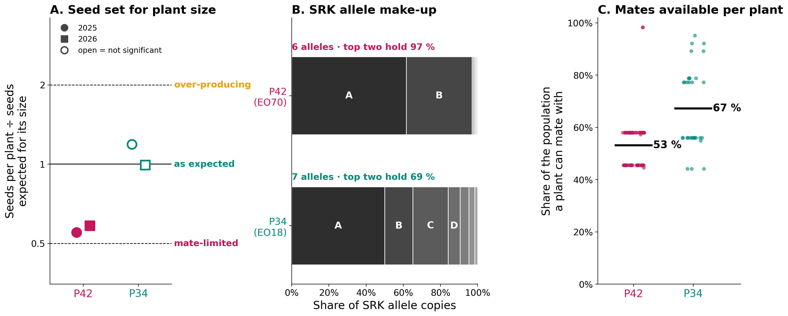

**Figure 9.** SRK genotypes of a mate-limited (P42, magenta) and a reproductively intact population (P34, teal). **A** — seed set relative to plant size per season, as in Figure 7 (circle = 2025, square = 2026; filled = significantly different from expectation); **B** — share of SRK allele copies per allele (letters; the same letter is the same allele in both); **C** — for each genotyped plant, the share of its population it can mate with under the self-incompatibility system, with the average. Data: [`tables/step32_genetic_example_P42_P34.tsv`](tables/step32_genetic_example_P42_P34.tsv).

---

## 6. Model populations for seed bulking

**The reproductively intact populations are the candidate sources**:
they set the seed their size predicts in both seasons, so their seed is
neither limited by a lack of compatible mates nor inflated by possible
self-fertilisation. Of the 44 populations, 37 have seed set measured, 12
in both seasons, and 3 of those are reproductively intact
([Figure 10](#fig-10)).

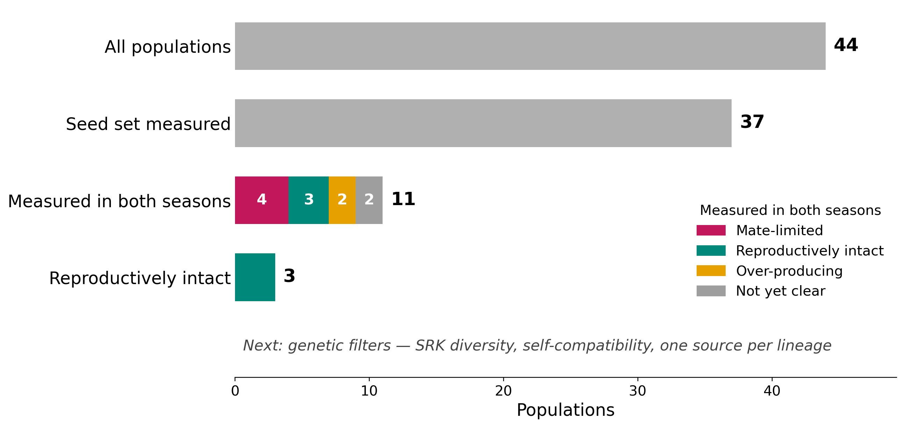

**Figure 10.** From all populations to candidate sources for seed bulking. The two-season populations are split by reproductive type; genetic filters come next.

| Population | BL | Fertile plants (2025 / 2026) | Plants measured (2025 / 2026) | Seed set for size (2025 / 2026) | Mothers with seed (2025 / 2026) |
|---|:-:|:-:|:-:|:-:|:-:|
| **P34** (EO18-7 + EO18-8) | BL3 | 523 / 1 150 | 113 / 239 | 1.19 / 0.99 | 115 / 239 |
| **P35** (EO25-A) | BL3 | 113 / 887 | 29 / 38 | 1.30 / 0.91 | 29 / 98 |
| **P43** (EO68-3) | BL5 | 48 / 23 | 21 / 10 | 1.19 / 1.05 | 21 / 10 |

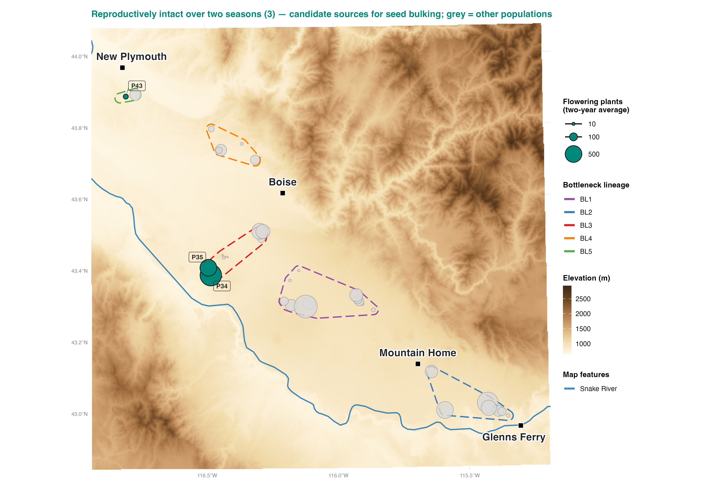

**Figure 11.** The three reproductively intact populations (teal) — candidate sources for seed bulking; other populations in grey; dashed outlines = Bottleneck Lineages.

**What to keep in mind.**
- All three set slightly more seed than expected in 2025 and the
  expected amount in 2026; they are intact once the shared 2026 drop is
  allowed for. A third season (2027) would confirm it.
- Two of the three lie in BL3 and one in BL5; BL1, BL2 and BL4 have no
  intact two-season population yet. Covering every lineage will need more
  seasons of data for the one-season populations.
- P34 is also the large population of the SRK genotyping design
  ([`Sampling_design.md`](Sampling_design.md)), so its SRK diversity will
  be known.
- Next filters before bulking: SRK diversity, self-compatibility status
  and representation of each BL.

---

## 7. Populations that need our attention — BL1 and EO27

**BL1 has no candidate source yet.** BL1, the largest lineage (17
populations), has five populations measured in both seasons, and none is
reproductively intact:

| Population | EO | Type (two seasons) | Seed set for size, 2025 / 2026 |
|---|---|---|---|
| P10 | EO27-3 | **mate-limited** — significant in both seasons | 0.42 / 0.03 |
| P16 | EO27-1 + EO27RT | **mate-limited** — significant in 2025 | 0.37 / 1.16 |
| P13 | EO27-1 | mate-limited (candidate) — not significant in either season | 0.79 / 1.14 |
| P6 | EO67 | mate-limited (candidate) — not significant in either season | 0.51 / 0.57 |
| P2 | EO30-1 | **over-producing** — significant in 2026 | 0.88 / 1.62 |

**EO27 stands out.** All four of its populations set less seed than their
size predicts in at least one season: P10 (EO27-3) significantly in both,
P16 (EO27-1 + EO27RT) significantly in 2025, P8 (EO27) significantly in
2025 (0.41, its only season so far) and P13 (EO27-1) in 2025 (0.79, not
significant). EO27 is the clearest cluster of mate limitation in the
dataset and the first place to confirm it genetically.

**P13 is a candidate to confirm.** Its seed set is not significantly
below expectation in either season — in 2026 it is slightly above — so
seed set alone does not show mate limitation. But its genotyped plants
have the lowest compatibility of any genotyped site: a plant can mate
with only about 44 % of its population (P42: 53 %, P34: 67 %), with 5 SRK
alleles and almost no Class I alleles. That rests on 12 plants from 7
mothers, so it is indicative; seed–mother genotyping of P13 would settle
it.

**What would complete the picture.**

1. **Clean the 2026 seed of P8 — first in the cleaning queue.** P8 was
   measured in 2025 and its mothers were collected in 2026, but none of
   its 2026 seed lots is cleaned yet, so it cannot be typed. P13's 2026
   lots are now cleaned and counted, which gave it its second season.

   | Population | EO (locationCode) | locationID | 2026 events (eventIDs) | Mothers collected, 2026 | Lots to clean |
   |---|---|---|---|---|---|
   | **P8** | EO27 | **9** | 17 (463 – 479) | 54 | **54** |

2. **Measure P5 (EO30-2) again in 2027.** P5 is the only BL1 population
   that sets the seed its size predicts (1.26 of expected, not
   significantly different, 34 plants), but it was above ground only in
   2026. Its 2026 lots (locationID 42) are already cleaned; what it needs
   is a second season. It is BL1's most likely candidate source.

With P8 typed and P5 measured a second time, every EO27 population would
have a firm call, and BL1 could gain its first candidate source for seed
bulking.

---

## 8. What this means for seed bulking and restoration

The three reproductive types play three different roles in a programme
that produces seed for restoration.

| Type | What it suggests | Role in the programme | Populations — two seasons (firm) | One season (to confirm) |
|---|---|---|---|---|
| **Reproductively intact** | Plants find enough compatible mates and outcross normally | **Sources for seed bulking** | **P34** (EO18, BL3), **P35** (EO25-A, BL3), **P43** (EO68-3, BL5) | P5 (EO30-2, BL1), P21, P22 (EO26, BL2), P28 (EO32, BL3), P30 (EO24-7, BL3), P38 (EO52, BL4), P39 (EO118, BL4), P41 (EO76, BL4) |
| **Mate-limited** | Too few compatible mates — seed set falls short | **Restoration targets**: receive seed from intact sources | **P10** (EO27-3), **P16** (EO27-1 + EO27RT), **P42** (EO70); candidates P6 (EO67), P13 (EO27-1), P36 (EO25-B) | P1 (EO112), P4 (EO30-3), P8 (EO27), P32 (EO24) |
| **Over-producing** | Likely escaped self-incompatibility and self-fertilise (self-compatible) | **Excluded** from the breeding programme | **P2** (EO30-1, BL1), **P37** (EO38, BL4) | P18 (EO8), P23 (EO26-3), P24 (EO26-1), P25 (EO61), all BL2; P40 (EO76, BL4) |

**Reproductively intact populations are the basis for seed bulking.**
Their seed comes from normal outcrossing among compatible plants, so a
small collection grown in the greenhouse multiplies seed that carries the
population's SRK diversity. The bulked seed is then used to restore the
mate-limited populations.

**Mate-limited populations need to be restored.** Their plants lack
compatible mates, so they cannot recover by themselves: seed translocated
from intact sources brings new SRK alleles and, with them, new compatible
mates. The genetic example (§ 5) shows what this means for P42: its
plants can mate with only about half of their population, and P34's
alleles differ from most of P42's (they share about a third of their
SRK alleles), so P34 seed would add compatible mates.

**Over-producing populations must stay out of seed production.** Setting
more seed than their size predicts is the expected signature of plants
that have escaped self-incompatibility and fertilise themselves. Selfing
exposes a population to **inbreeding depression**, and self-compatible
plants would spread selfing through any population they are mixed into,
so these populations cannot be part of a breeding programme for seed
production. The genotypes already point the same way at EO76: of its 77
genotyped plants, one carries no functional SRK allele — a self-compatible
plant. EO76 holds P40, which over-produced in 2025, and P41; the site is
genotyped as one, so the plant cannot yet be placed in either.

**What to confirm before acting.**
- **The over-producing call is a hypothesis.** Seed–mother genotyping
  will test it directly: seedlings of a selfing mother carry only her own
  SRK alleles.
- **Sources need the genetic filters too** — enough SRK diversity, no
  self-compatible plants and, ideally, one source per lineage.
- **Recipients should receive alleles they lack**, which SRK genotypes of
  both source and recipient will show.
- **One-season populations** keep their place in the table only
  provisionally; a second season of data decides their role.

---

**Reproducing the figures.** `./run_pipeline.sh bulking` runs
`Scripts/step32_seed_bulking.py` (table and seed-by-size figures) and
`Scripts/step32_seed_bulking_maps.R` (maps); the background maps of § 2
come from `./run_pipeline.sh talkmaps`.
