# Towards prioritising slickspot peppergrass populations for seed production

**What this document is.** The companion to the NCA Symposium talk
(15 minutes) and the source of its figures: which *Lepidium
papilliferum* populations meet the reproductive requirements for **seed
bulking**, based on field data (seed set for plant size) and the genetic
framework of [`Project_outline.md`](Project_outline.md). All figures are
in [`figures_seed_bulking/`](figures_seed_bulking/); the population table is
[`tables/step32_seed_bulking_populations.tsv`](tables/step32_seed_bulking_populations.tsv).

> **Main result.** Of 44 populations, only **4 are reproductively intact
> over two seasons** — their seed set is significantly within half –
> twice what their plants' size predicts in both seasons — and qualify
> as sources for seed bulking: **P34** (EO18) and **P35** (EO25-A) in
> BL3, **P43** (EO68-3) in BL5 and **P13** (EO27-1) in BL1, covering
> three of the five lineages. Eight more look intact but have a single
> season of data, so a second season could add sources, including the
> first for BL2 and BL4 (§ 6.3.3, § 6.4.3). All four still need the
> genetic filters (SRK diversity, no self-compatible plants) before
> bulking. **Where SRK genotypes already exist, they mostly back the
> seed-set call:** P34 (32 genotyped plants) carries a balanced set of
> SRK alleles, no self-compatible plants and more compatible mates than
> the mate-limited P42 (67 % against 53 %; § 6.3.2). P13 is the
> exception: its few genotyped plants (12) can mate with only 44 % of
> their population, so it is the source to confirm first (§ 6.4.2).

**Colours used throughout the talk.** Each population's reproductive
type has one colour on every figure and map, distinct from the
Bottleneck Lineage (BL) colours, which appear on maps as dashed outlines:

| Type | Colour | Meaning |
|---|---|---|
| **Mate-limited** | magenta `#C2185B` | sets less seed than its plants' size predicts (hollow = candidate) |
| **Reproductively intact** | teal `#00897B` | sets the seed its plants' size predicts |
| **Over-producing** | gold `#E6A100` | sets more seed than its size predicts — a possible sign of self-fertilisation (SI escape) |
| Not yet clear | grey `#9E9E9E` | switches between seasons |
| One season only | light grey `#D9D9D9` | seed data in a single season — more data required |

*Authors:* Sven Buerki, Peggy Martinez, Mathew Geisler, Sam Billingsley,
Isaac Carretero, Kylie Stear, Alex Scott, Jayden Yun, Elizabeth Berrier,
Ashley Zahurak & Ian Robertson.

**Contents.** [1. Challenge and goal](#1-challenge-and-goal) ·
[2. Our approach](#2-our-approach) ·
[3. What we know so far](#3-what-we-know-so-far) ·
[4. Objectives](#4-objectives) ·
[5. Objective 1 — Define populations](#5-objective-1--define-populations) ·
[6. Objective 2 — Determine candidate populations for seed bulking](#6-objective-2--determine-candidate-populations-for-seed-bulking) ·
[7. Conclusions](#7-conclusions) · [References](#references)

---

## 1. Challenge and goal

**The challenge.** Slickspot peppergrass is federally threatened, and
wild populations have limited fertility, so a restoration programme
starts with very little seed. This scarcity impedes population
restoration.

**The goal.** To re-establish reproduction in mate-limited populations
while keeping as much genetic diversity as possible, through a
two-stage programme ([Figure 1](#fig-1)):

1. **Seed bulking** — collecting a small number of seeds from a source
   population and growing them in a greenhouse to harvest a much larger
   quantity;
2. **Informed breeding** — crossing plants chosen by their SRK genotypes,
   to produce seed for restoration through seed translocation.

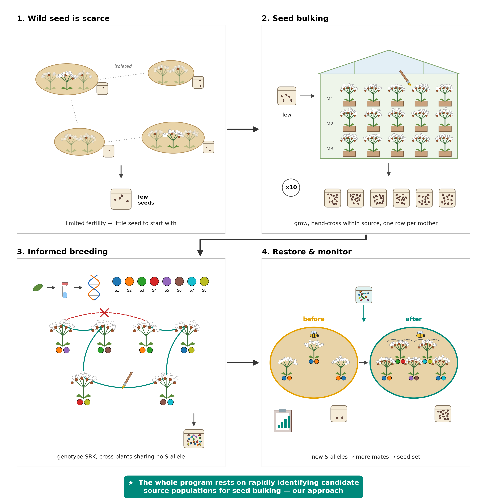

**Figure 1.** The restoration programme, with slickspot peppergrass as the model. **1** — wild populations are small, isolated and of limited fertility: there is little seed to start with. **2** — seed bulking: the few wild seeds from source populations are grown in the greenhouse and hand-crossed within each source, one row per mother so families stay tracked, multiplying seed. **3** — informed breeding: plants are genotyped at SRK (coloured dots = S-alleles) and only plants that share no S-allele are crossed, rare alleles first, so the seed carries many S-alleles in balanced numbers. **4** — that seed is sown into a mate-limited population: the new S-alleles give each plant more compatible mates and seed set recovers; seed set and S-alleles are monitored. Plants and alleles are invented. Source: `Scripts/restoration_cartoon.py`; one frame per step for slides: `restoration_cartoon_step1–3.png`.

---

## 2. Our approach

The whole programme rests on **rapidly identifying candidate source
populations for seed bulking** — populations that are reproductively
intact, or as close as possible. Sources must meet specific reproductive
and genetic requirements. Genotyping every population is slow and
costly; our approach is fast and low cost, using what is measured on
every plant anyway: **seed set for plant size** ([Figure 2](#fig-2)),
with SRK genotypes as the genetic check where they exist (§ 6).

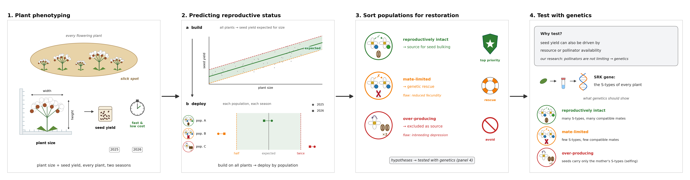

**Figure 2.** Our approach to identify candidate sources. **1** — the crown size (width, height) and seeds of every flowering plant are measured in two seasons: fast and low cost, no genotyping. **2** — all plants together give the seed a plant of a given size is expected to set (teal line; band from half, magenta, to twice, gold). **3** — each population's seed set relative to what its plants' size predicts, per season (circle = 2025, square = 2026): below half (mate-limited), as expected (reproductively intact) or above twice (over-producing). **4** — intact populations are the candidate sources for seed bulking (in LEPA P13, P34, P35 and P43); mate-limited populations are restoration targets; over-producing populations, likely self-compatible, are excluded; SRK genotypes are the next check. Plants and values are invented. Source: `Scripts/source_screening_cartoon.py`; one frame per step for slides: `source_screening_cartoon_step1–3.png`.

---

## 3. What we know so far

Slickspot peppergrass is an allopolyploid (four copies of each
chromosome) whose populations are **declining and setting less seed**,
independently of habitat quality, which points to a biological limit on
reproduction ([Buerki et al., 2026](#ref-buerki2026)). Our research shows
that:

- **Populations cluster into two genetic groups**, Snake River Plain (SRP)
  and Jarbidge (JAR), which now define the species' management regions
  ([Buerki et al., 2026](#ref-buerki2026)); this work covers SRP
  ([Figure 3](#fig-3)).
- **The landscape is heavily fragmented** — five fragments, the
  Bottleneck Lineages, across SRP ([Figure 4](#fig-4)).
- **The species is self-incompatible (SI)**, a trait under genetic
  control: a plant can only be fertilised by a mate of a different
  S-type ([Figure 5](#fig-5), panels 1 – 2).
- **Some populations have escaped SI** and become self-compatible
  ([Figure 5](#fig-5), panels 3 – 4).
- **Populations have declined significantly** over the last 15 years
  (see references in [Buerki et al., 2026](#ref-buerki2026)).

**Where the populations are.** Within SRP, we sampled the element
occurrences (EOs) recorded for the species, from a handful of flowering
plants to several hundred ([Figure 3](#fig-3)).

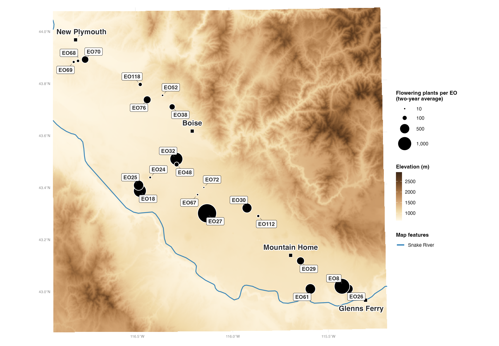

**Figure 3.** The element occurrences (EOs) sampled across the Snake River Plain, sized by flowering plants (two-year average).

**Five fragments.** The EOs fall into five fragments, the Bottleneck
Lineages (BL1 – BL5), separated by gaps too wide for pollinators or seed
to cross ([Figure 4](#fig-4)); each lineage evolves largely on its own,
so a lineage that loses diversity cannot regain it from its neighbours.

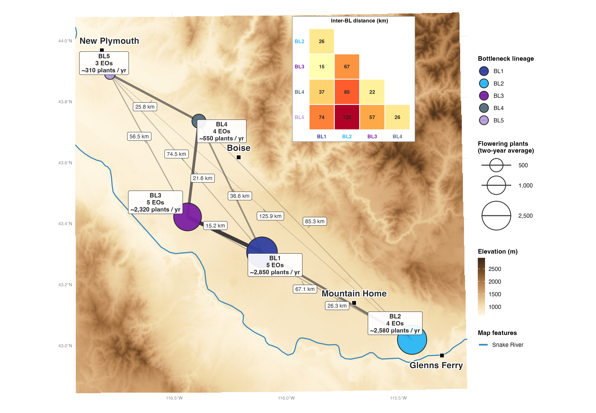

**Figure 4.** The five fragments (Bottleneck Lineages), with the shortest distance between them.

**The breeding system in brief** ([Figure 5](#fig-5)). Self-incompatibility
is a genetic system that prevents a plant from fertilising itself. The
**S-locus** (combining a male and a female gene: SCR, carried by the
pollen, and SRK, on the stigma) gives each plant an S-type, and pollen
carrying the flower's own S-type is rejected ([Figure 5](#fig-5), panel 1).
It protects the species from inbreeding, but it has a cost: in small,
isolated populations S-types are lost, plants run out of compatible
mates and set less seed than their size predicts — **mate limitation**
(panel 2). Some plants have escaped the system: with their S-locus copies
broken, they accept their own pollen and set seed alone — more seed
than their size predicts (panel 3) — but selfing leads to
**inbreeding**, offspring that are more alike and weaker (panel 4). Of
263 LEPA plants genotyped at the S-locus, 247 are self-incompatible, 15
have some copies broken and 1 is fully self-compatible. These two
signatures in seed set — too little and too much — are what our
approach reads in the field ([Figure 2](#fig-2)).

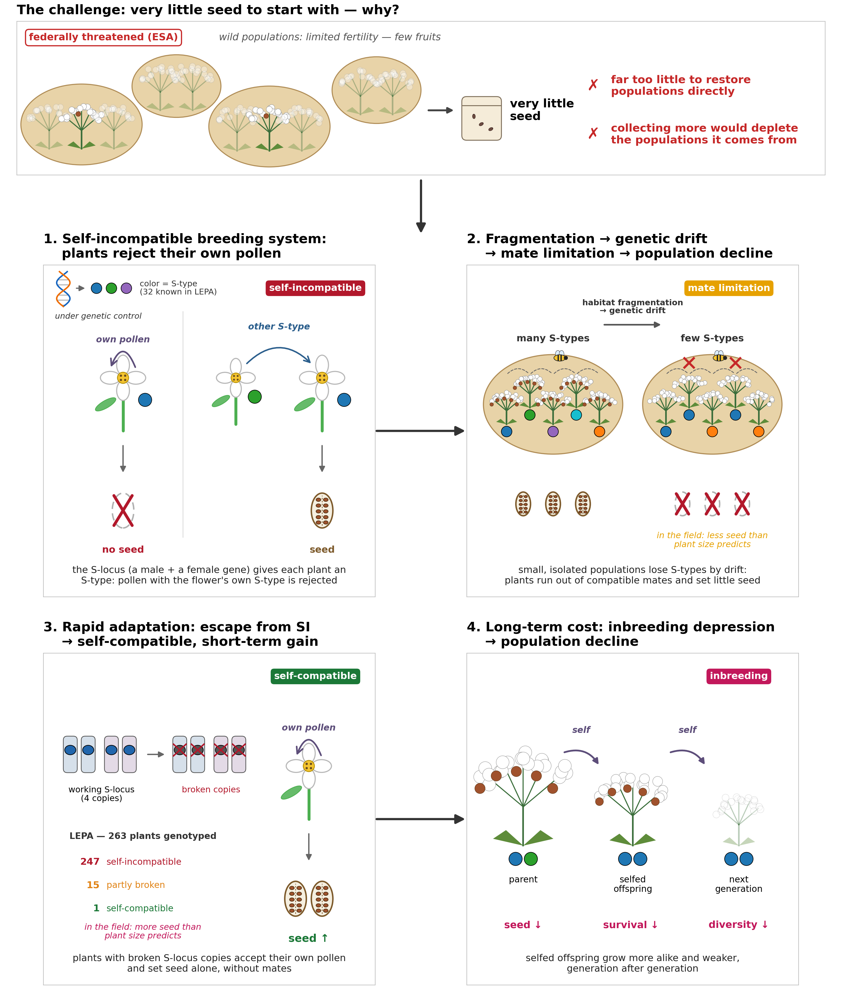

**Figure 5.** The breeding system of slickspot peppergrass. **1** — the S-locus (combining a male and a female gene) gives each plant an S-type (colour; 32 are known in LEPA); pollen with the flower's own S-type is rejected (no seed), pollen of another S-type is accepted (seed). **2** — few S-types → mate limitation → population decline: small, isolated populations lose S-types, so plants find few compatible mates and set little seed. **3** — plants whose S-locus copies are broken (LEPA has four copies of each chromosome) accept their own pollen and set seed alone (self-compatible); of 263 genotyped plants, 247 are self-incompatible, 15 have some copies broken and 1 is self-compatible. **4** — selfing → inbreeding → reduced fitness → population decline: selfed offspring are more alike and weaker, generation after generation (less seed, lower survival, less diversity). Flower, pollen and fruit drawings from the breeding-system figures of the SRK genotyping pipeline ([SRK_bioinformatics](https://github.com/svenbuerki/SRK_bioinformatics)). Source: `Scripts/breeding_system_cartoon.py`; one frame per panel for slides: `breeding_system_cartoon_step1–3.png`.

---

## 4. Objectives

To reach the goal (§ 1) with our approach (§ 2), we need to:

1. **Define populations** (§ 5) — the population is the biological unit
   of both seed bulking (the source of the seed) and restoration (the
   target that receives it), so every result rests on how it is drawn.
2. **Determine candidate populations for seed bulking** (§ 6) — find the
   populations that are reproductively intact, and those that are
   mate-limited (restoration targets) or over-producing (excluded).

Each objective is presented as approach, methods and materials,
results, and discussion; § 7 summarises the outcomes by objective and
what to do next.

---

## 5. Objective 1 — Define populations

### 5.1 Approach

A population must group the plants that exchange pollen and seed, and
be separate enough from the next population that it can be treated as
a source or a target on its own. Pollinator flight sets the mating
unit, the **deme**; the **population** groups the slick spots that stay
together across seasons ([Figure 6](#fig-6)).

### 5.2 Methods and materials

Every slick spot surveyed in a season is an **event**, and its
flowering plants are counted. Within a season, slick spots less than
**50 m** apart (pollinator flight) are linked, and each connected group
is a **deme**, the group of plants that actually mate with each other;
a slick spot on its own is a deme by itself. Slick spots of all seasons
(so far 2025 and 2026) less than **500 m** apart are linked into one
**population** — far enough from the next population that pollen and
seed rarely move between them — inside which demes are redrawn each
season. The rules are applied to every slick spot surveyed in 2025 and
2026 in the LEPA database (`./run_pipeline.sh units`).

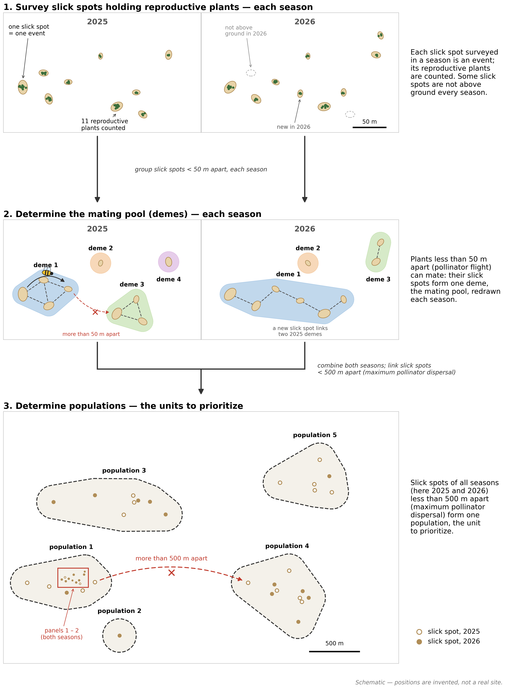

**Figure 6.** Slick spot (event) → deme → population. **1** — the same ground in 2025 (left) and 2026 (right): each slick spot surveyed in a season is an event, and its flowering plants are counted; some slick spots are not above ground in a season (dashed), others appear. **2** — within each season, pollinators move between slick spots less than 50 m apart, which then form one deme; a slick spot on its own is a deme by itself. Demes are redrawn every season: here a new 2026 slick spot links two 2025 demes. **3** — the two seasons combined: slick spots of both seasons (open = 2025, filled = 2026) less than 500 m apart form one population; slick spots more than 500 m apart (red ✗) belong to different populations; the red box marks where the close-up of panels 1 – 2 lies. Positions are invented. Source: `Scripts/units_cartoon.py`.

### 5.3 Results

The rules give **44 populations** in 21 EOs across the five Bottleneck
Lineages ([Figure 7](#fig-7)):

| Lineage | EOs | Populations | Present in both seasons |
|---|:-:|:-:|:-:|
| BL1 | 5 | 17 | 6 |
| BL2 | 4 | 9 | 7 |
| BL3 | 5 | 10 | 7 |
| BL4 | 4 | 5 | 4 |
| BL5 | 3 | 3 | 2 |
| **Total** | **21** | **44** | **26** |

BL1 holds the most populations but the smallest share present in both
seasons (6 of 17); across all lineages, 18 populations were above ground in
only one of the two seasons.

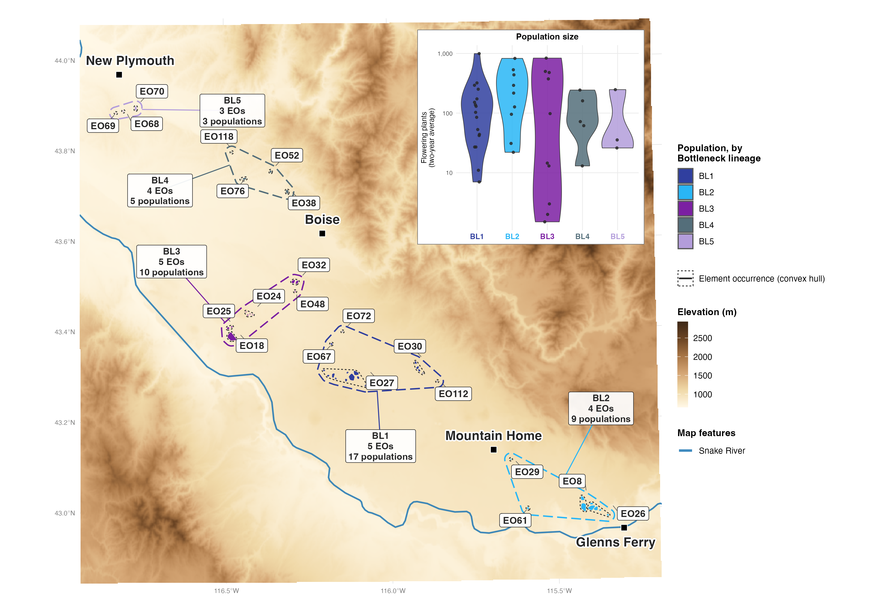

**Figure 7.** Every population at its real extent, coloured by BL, with EO outlines; inset: population size per BL. The EO map coloured by BL is [`EO_sampling_map_BL.png`](figures_seed_bulking/EO_sampling_map_BL.png); the fine-scale maps, one per BL, are kept locally (`./run_pipeline.sh talkmaps`).

### 5.4 Discussion

- **The population, not the EO, is the unit.** An EO can hold several
  populations (EO27 holds four), and one population can span parts of
  two EOs (P34 = EO18-7 + EO18-8). Seed bulking draws its source seed
  from whole populations and restoration targets whole populations, so
  deciding which population is a source rests on this definition.
- **Demes are the unit of mating.** They set how many mothers to sample
  within a population for SRK genotyping
  ([`Sampling_design.md`](Sampling_design.md)).
- **Many populations are seen in one season only** (18 of 44), because
  plants are not above ground every year. A population needs two
  seasons of data before its reproductive type can be called (§ 6.2), so
  the one-season populations are the first place where more data will
  add candidate sources.

---

## 6. Objective 2 — Determine candidate populations for seed bulking

### 6.1 Approach

The **reproductively intact populations are the candidate sources**:
they set the seed their plants' size predicts, so their seed is neither
limited by a lack of compatible mates nor inflated by possible
self-fertilisation. A population whose plants set, on average,
significantly less seed than their size predicts is **mate-limited**;
significantly more, **over-producing**; neither, **reproductively
intact** ([Figure 2](#fig-2)). These seed-set types are hypotheses about
reproduction; SRK genotypes, where they exist, are the genetic check.

### 6.2 Methods and materials

**Plant size and seed.** Every plant whose seeds were collected is
photographed against a whiteboard with rulers to measure its crown and
height ([Figure 8](#fig-8)), and its seeds are counted. Larger plants set
more seed. Across all **1 509 plants measured in 2025 and 2026**, seed
count rises with crown size along one curve shared by all populations,
so each plant has an expected seed set for its size
([Figure 9](#fig-9)).

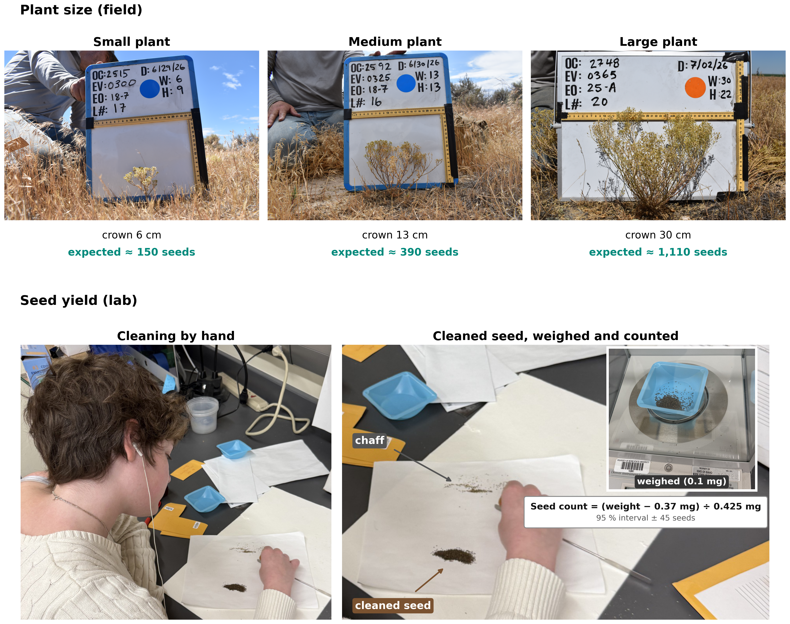

**Figure 8.** Plant size phenotyping in the field, 2026: a small, a medium and a large plant photographed against the measuring board (crown width and height on the rulers), with their crown size and the seed a plant of that size is expected to set (the teal line of [Figure 9](#fig-9)): about 150, 390 and 1 040 seeds. All three set about the seed their size predicts. Photos with location metadata removed: `figures_seed_bulking/plant_photos/`.

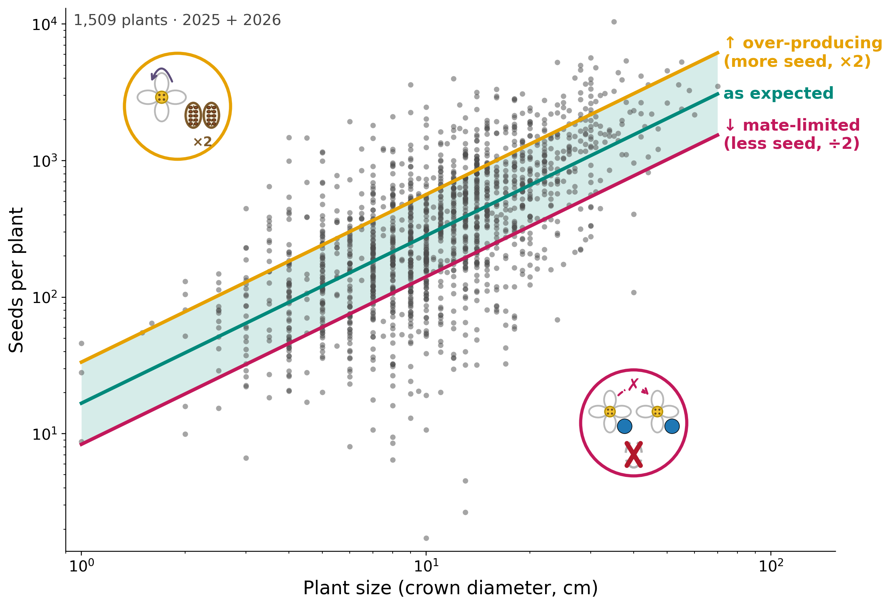

**Figure 9.** Seeds per plant against plant size (crown diameter), 1 509 plants, both seasons; log scales. Teal line = the seed a plant of that size is expected to set (the relationship shared by all populations); teal band = as expected, between half (magenta line) and twice (gold line) that seed — the colours of the three reproductive types used in the rest of the talk. Icons: over-producing (gold — a flower pollinating itself, extra fruit) above the gold line; mate-limited (magenta — two flowers of the same S-type, pollen rejected, empty fruit) below the magenta line.

**Only populations with two seasons of data are typed.** All plants
shape the curve, but a population is typed only if at least 3 of its
plants were measured in **both** 2025 and 2026, so that no call rests on
a single good or bad season. Seed set was 15 % lower in 2026 across
populations; the types allow for that shared drop. Each season is
tested twice, with a false-discovery correction (q < 0.05): does seed
set **differ** from expectation (below = mate-limited, above =
over-producing), and is it significantly **within** half – twice the
expectation (an equivalence test, two one-sided t-tests)? The second
test makes "reproductively intact" a positive result rather than the
absence of a significant difference. A population is a mate-limited
**candidate** when its seed set trends below expectation (under 0.8 in
a season) but neither test is conclusive.

**Genetic check.** Where a population's plants are genotyped at SRK
(the Canu-amplicon pipeline of
[SRK_bioinformatics](https://github.com/svenbuerki/SRK_bioinformatics)),
its SRK alleles and the share of the population each plant can mate
with under the self-incompatibility system are compared with its
seed-set type.

`./run_pipeline.sh bulking` runs `Scripts/step32_seed_bulking.py`
(table and seed-by-size figures) and `Scripts/step32_seed_bulking_maps.R`
(maps).

### 6.3 Results

#### 6.3.1 Reproductive type of every population

**12 populations** have two seasons of data and are typed; the other
**25 have one season of data and need more before they can be typed** —
they stay on every figure in light grey.

| Type | Populations (BL) |
|---|---|
| **Mate-limited** | P10 EO27-3 (BL1), P16 EO27-1 + EO27RT (BL1), P42 EO70 (BL5); candidates P6 EO67 (BL1), P36 EO25-B (BL3) |
| **Reproductively intact** | **P13** EO27-1 (BL1), **P34** EO18-7 + EO18-8 (BL3), **P35** EO25-A (BL3), **P43** EO68-3 (BL5) |
| **Over-producing** | P2 EO30-1 (BL1), P37 EO38 (BL4) |
| Not yet clear | P19 EO8 (BL2) — significantly above expectation in 2025, below in 2026 |

Among the one-season populations, four show a strong seed shortfall
(P1 EO112, P4 EO30-3, P8 EO27, P32 EO24) and should be measured again
before they are typed ([Figure 10](#fig-10), [Figure 11](#fig-11)).

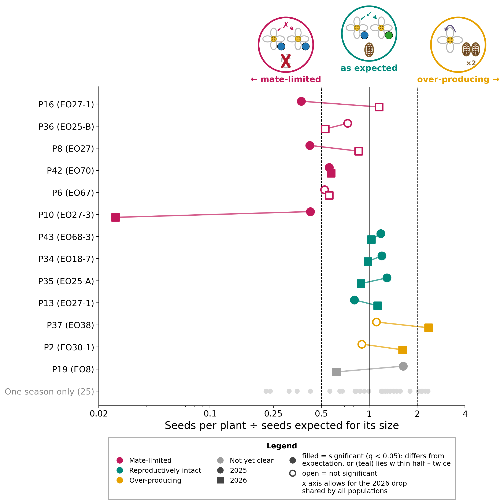

**Figure 10.** Seed set relative to what plant size predicts, per population and season, allowing for the 2026 drop shared by all populations; 1 = as expected, dashed lines = half and twice. Circle = 2025, square = 2026; **filled = that season differs significantly from expectation** (false-discovery-corrected q < 0.05), open = not significant. P10 and P42 are significantly below expectation in both seasons and P16 in 2025; P2 and P37 significantly above in 2026 only; the four intact populations (P13, P34, P35, P43) are significantly within half – twice in both seasons (filled teal); P6 and P36 (candidates) are not significant either way; P19 is significant in opposite directions. Bottom row: the 25 one-season populations. Icons above the headers: mate-limited (two flowers of the same S-type, pollen rejected, empty fruit), as expected (two flowers of different S-types, pollen accepted, full fruit) and over-producing (a flower pollinating itself, extra fruit) — the breeding-system logic of [Figure 5](#fig-5).

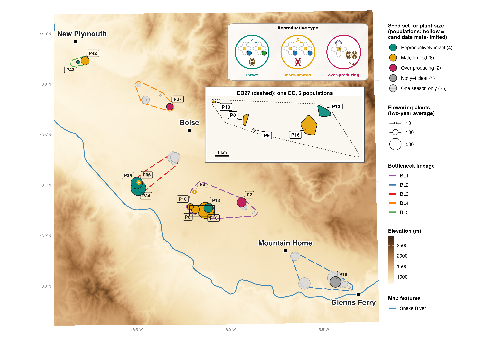

**Figure 11.** Reproductive type of every population on the Snake River Plain, sized by flowering plants; dashed outlines = Bottleneck Lineages. Inset: the reproductive-type icons of [Figures 9](#fig-9) and [10](#fig-10). Smaller populations are drawn on top, so P13 shows over the larger P16 at EO27-1.

#### 6.3.2 A genetic example — P42 against P34

Two of the typed populations already have SRK genotypes: **P42**
(EO70), mate-limited in both seasons, and **P34** (EO18), reproductively
intact in both seasons ([Figure 12](#fig-12)).

- **Seed set (A).** P42 sets about half the seed its plants' size
  predicts in both seasons; P34 sets the expected amount.
- **S-types carried (B).** The two populations hold a similar number of
  S-types (SRK alleles): 6 in P42 and 7 in P34. What differs is how they
  are shared: in P42 two S-types make up 97 % of all copies, while P34
  has four main S-types (90 %), more evenly spread.
- **Compatible mates (C).** Because most of P42's plants carry the same
  two alleles, a plant can mate, on average, with **53 %** of its
  population; in P34, with **67 %**. The two ranges do not overlap
  (P42 0.51 – 0.56, P34 0.61 – 0.72).

The genetics point to the same answer as seed set for plant size: **P42 is short
of compatible mates, P34 is not** — although P34's 67 % is itself below
the 78 % expected if its alleles were a random sample of the species, so
it too has lost diversity, just not enough to depress its seed set. This
is one pair — an example, not a
test across populations. P42's genotyped plants are mostly seedlings
from 10 wild mothers and P34's are 32 plants, and siblings are not yet
corrected for. The SRK genotyping of P34 planned for 2025 – 2026 seed
([`Sampling_design.md`](Sampling_design.md)) will extend this
comparison.

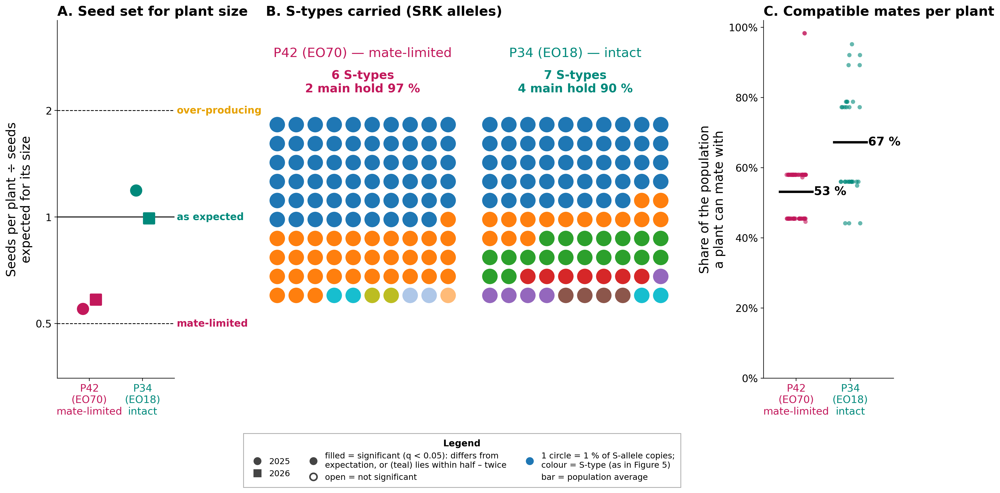

**Figure 12.** SRK genotypes of a mate-limited (P42, magenta) and a reproductively intact population (P34, teal). **A** — seed set for plant size per season, as in [Figure 10](#fig-10) (circle = 2025, square = 2026; filled = significant: P42 differs from expectation, P34 lies within half – twice). **B** — the S-types carried: 100 circles per population, one circle = 1 % of S-allele copies, one colour per S-type as in [Figure 5](#fig-5) (the same colour is the same S-type in both). Both hold 6 – 7 S-types, but P42 has two main ones and P34 four (main = at least 5 % of copies). **C** — for each genotyped plant, the share of its population it can mate with under the self-incompatibility system; bar = average. Data: [`tables/step32_genetic_example_P42_P34.tsv`](tables/step32_genetic_example_P42_P34.tsv).

#### 6.3.3 Candidate sources for seed bulking

Of the 44 populations, 37 have seed set measured, 12 in both seasons,
and 4 of those are reproductively intact ([Figure 13](#fig-13),
[Figure 14](#fig-14)).

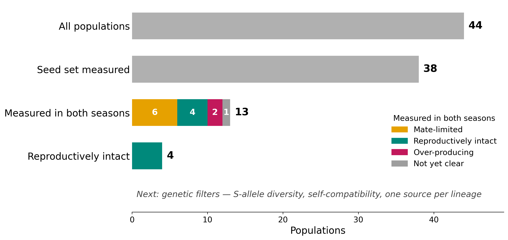

**Figure 13.** From all populations to candidate sources for seed bulking. The two-season populations are split by reproductive type; genetic filters come next.

| Population | BL | Fertile plants (2025 / 2026) | Plants measured (2025 / 2026) | Seed set for size (2025 / 2026) | Mothers with seed (2025 / 2026) |
|---|:-:|:-:|:-:|:-:|:-:|
| **P13** (EO27-1) | BL1 | 395 / 191 | 24 / 38 | 0.79 / 1.14 | 26 / 38 |
| **P34** (EO18-7 + EO18-8) | BL3 | 523 / 1 150 | 113 / 239 | 1.19 / 0.99 | 115 / 239 |
| **P35** (EO25-A) | BL3 | 113 / 887 | 29 / 38 | 1.30 / 0.91 | 29 / 98 |
| **P43** (EO68-3) | BL5 | 48 / 23 | 21 / 10 | 1.19 / 1.05 | 21 / 10 |

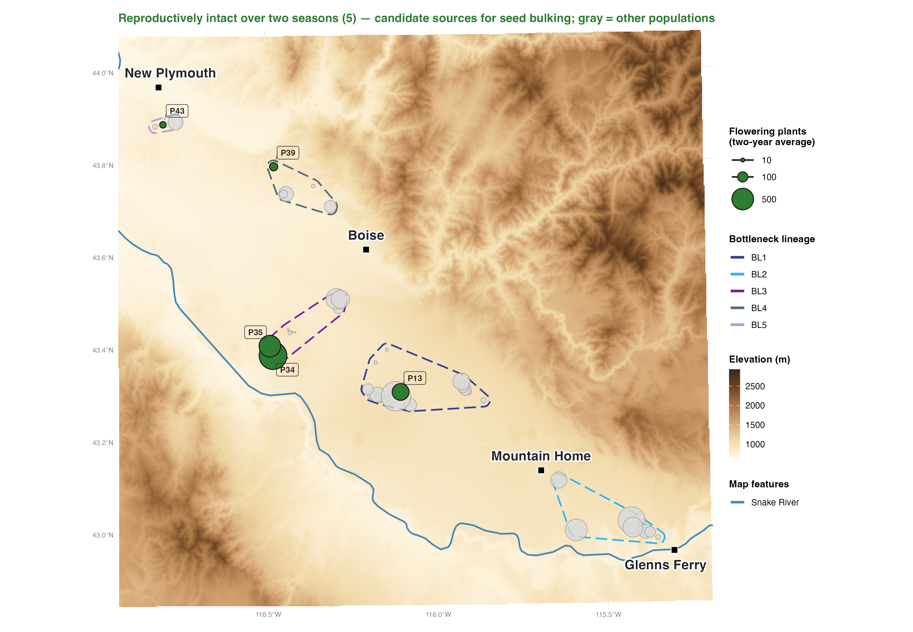

**Figure 14.** The four reproductively intact populations (teal) — candidate sources for seed bulking; other populations in grey; dashed outlines = Bottleneck Lineages.

**What to keep in mind.**
- All four are significantly within half – twice the expected seed set in
  both seasons. P34, P35 and P43 set slightly more than expected in 2025
  and the expected amount in 2026; P13 slightly less in 2025 (0.79) and
  slightly more in 2026. A third season (2027) would confirm them.
- Two lie in BL3, one in BL5 and one in BL1; BL2 and BL4 have no intact
  two-season population yet. Covering every lineage will need more
  seasons of data for the one-season populations.
- **P13 needs its genetics checked first.** Its seed set is as expected,
  but its few genotyped plants have the lowest compatibility of any
  genotyped site (§ 6.4.2).
- P34 is also the large population of the SRK genotyping design
  ([`Sampling_design.md`](Sampling_design.md)), so its SRK diversity will
  be known.
- Next filters before bulking: SRK diversity, self-compatibility status
  and representation of each BL.

### 6.4 Discussion

#### 6.4.1 What seed set cannot tell us on its own

Seed set for plant size is a powerful first screen — it covers every
population, needs no lab work and flags where reproduction falls short.
But **seed yield also depends on resources**: water and soil conditions
in the slick spots, the weather of the season, herbivory, pollinator
visits and the condition of each plant. Our test already allows for
plant size (which partly reflects resources) and for the drop in 2026
shared by all populations, but not for conditions that differ from site
to site. A population on a dry site could set less seed for its size
without any shortage of mates; a well-watered one could hide a mild
shortage.

The seed-yield types are therefore **hypotheses about reproduction**.
To confirm that a population is mate-limited — that its plants lack
compatible mates — we need its **SRK genotypes**: a mate-limited
population should hold fewer SRK alleles, or alleles so unevenly shared
that each plant can mate with only part of the population. Where they
exist, they mostly agree with seed set (§ 6.3.2); P13 is the exception
(§ 6.4.2). The equivalence test strengthens the intact call — it shows
that seed set is within the expected range, not merely that no
shortfall was detected — but it cannot rule out a site whose resources
mask a shortage of mates.

#### 6.4.2 Populations that need our attention — BL1 and EO27

**BL1 has one candidate source, to confirm.** BL1, the largest lineage
(17 populations), has five populations measured in both seasons, and
one of them — P13 — is reproductively intact:

| Population | EO | Type (two seasons) | Seed set for size, 2025 / 2026 |
|---|---|---|---|
| P10 | EO27-3 | **mate-limited** — significant in both seasons | 0.42 / 0.03 |
| P16 | EO27-1 + EO27RT | **mate-limited** — significant in 2025 | 0.37 / 1.16 |
| P13 | EO27-1 | **reproductively intact** — within half – twice in both seasons | 0.79 / 1.14 |
| P6 | EO67 | mate-limited (candidate) — not significant in either season | 0.51 / 0.57 |
| P2 | EO30-1 | **over-producing** — significant in 2026 | 0.88 / 1.62 |

**EO27 stands out.** Three of its four populations set significantly
less seed than their size predicts: P10 (EO27-3) in both seasons, P16
(EO27-1 + EO27RT) in 2025 and P8 (EO27) in 2025 (0.41, its only season
so far). The fourth, P13 (EO27-1), sets the seed its size predicts.
EO27 is the clearest cluster of mate limitation in the dataset and the
first place to confirm it genetically.

**P13: intact by seed set, at odds with its genetics.** Its seed set
is significantly within half – twice the expectation in both seasons
(0.79 in 2025, 1.14 in 2026), so by seed set it is reproductively intact
— BL1's only candidate source. But its genotyped plants have the lowest
compatibility of any genotyped site: a plant can mate with only about
44 % of its population (P42: 53 %, P34: 67 %), with 5 SRK alleles and
almost no Class I alleles. That rests on 12 plants from 7 mothers, so it
is indicative. Before P13 is used for seed bulking, more of its mothers
should be genotyped — seed–mother genotyping would show whether its
plants find compatible mates — and its 2027 seed set would confirm the
call.

**What would complete the picture.**

1. **Clean the 2026 seed of P8 — first in the cleaning queue.** P8 was
   measured in 2025 and its mothers were collected in 2026, but none of
   its 2026 seed lots is cleaned yet, so it cannot be typed. P13's 2026
   lots are now cleaned and counted, which gave it its second season.

   | Population | EO (locationCode) | locationID | 2026 events (eventIDs) | Mothers collected, 2026 | Lots to clean |
   |---|---|---|---|---|---|
   | **P8** | EO27 | **9** | 17 (463 – 479) | 54 | **54** |

2. **Measure P5 (EO30-2) again in 2027.** P5 is the only BL1 population
   that sets the seed its size predicts (1.26 of expected, not
   significantly different, 34 plants), but it was above ground only in
   2026. Its 2026 lots (locationID 42) are already cleaned; what it needs
   is a second season. It is BL1's most likely candidate source.

With P8 typed, P13's genetics checked and P5 measured a second time,
every EO27 population would have a firm call, and BL1 could hold one or
two candidate sources for seed bulking.

#### 6.4.3 What this means for seed bulking and restoration

The three reproductive types play three different roles in the
programme that produces seed for restoration ([Figure 1](#fig-1),
[Figure 2](#fig-2)).

| Type | What it suggests | Role in the programme | Populations — two seasons (firm) | One season (to confirm) |
|---|---|---|---|---|
| **Reproductively intact** | Plants find enough compatible mates and outcross normally | **Sources for seed bulking** | **P34** (EO18, BL3), **P35** (EO25-A, BL3), **P43** (EO68-3, BL5), **P13** (EO27-1, BL1; genetics to confirm) | P5 (EO30-2, BL1), P21, P22 (EO26, BL2), P28 (EO32, BL3), P30 (EO24-7, BL3), P38 (EO52, BL4), P39 (EO118, BL4), P41 (EO76, BL4) |
| **Mate-limited** | Too few compatible mates — seed set falls short | **Restoration targets**: receive seed from intact sources | **P10** (EO27-3), **P16** (EO27-1 + EO27RT), **P42** (EO70); candidates P6 (EO67), P36 (EO25-B) | P1 (EO112), P4 (EO30-3), P8 (EO27), P32 (EO24) |
| **Over-producing** | Likely escaped self-incompatibility and self-fertilise (self-compatible) | **Excluded** from the breeding programme | **P2** (EO30-1, BL1), **P37** (EO38, BL4) | P18 (EO8), P23 (EO26-3), P24 (EO26-1), P25 (EO61), all BL2; P40 (EO76, BL4) |

**Reproductively intact populations are the basis for seed bulking.**
Their seed comes from normal outcrossing among compatible plants, so a
small collection grown in the greenhouse multiplies seed that carries the
population's SRK diversity. The bulked seed is then used to restore the
mate-limited populations.

**Mate-limited populations need to be restored.** Their plants lack
compatible mates, so they cannot recover by themselves: seed translocated
from intact sources brings new SRK alleles and, with them, new compatible
mates. The genetic example (§ 6.3.2) shows what this means for P42: its
plants can mate with only about half of their population, and P34's
alleles differ from most of P42's (they share about a third of their
SRK alleles), so P34 seed would add compatible mates.

**Over-producing populations must stay out of seed production.** Setting
more seed than their size predicts is the expected signature of plants
that have escaped self-incompatibility and fertilise themselves
([Figure 5](#fig-5), panels 3 – 4). Selfing exposes a population to
**inbreeding depression**, and self-compatible plants would spread
selfing through any population they are mixed into, so these
populations cannot be part of a breeding programme for seed production.
The genotypes already point the same way at EO76: of its 77 genotyped
plants, one carries no functional SRK allele — a self-compatible plant.
EO76 holds P40, which over-produced in 2025, and P41; the site is
genotyped as one, so the plant cannot yet be placed in either.

**What to confirm before acting.**
- **The over-producing call is a hypothesis.** Seed–mother genotyping
  will test it directly: seedlings of a selfing mother carry only her own
  SRK alleles.
- **Sources need the genetic filters too** — enough SRK diversity, no
  self-compatible plants and, ideally, one source per lineage.
- **Recipients should receive alleles they lack**, which SRK genotypes of
  both source and recipient will show.
- **One-season populations** keep their place in the table only
  provisionally; a second season of data decides their role.

---

## 7. Conclusions

**Objective 1 — Define populations.**
- **Outcome.** Pollinator flight (50 m demes) and cross-season grouping
  (500 m populations) give **44 populations** in 21 EOs across the five
  Bottleneck Lineages; 26 are present in both seasons. The population is
  the unit for both seed bulking and restoration.
- **Next.** Add each new season with the same rules, so that the
  one-season populations gain the second season they need.

**Objective 2 — Determine candidate populations for seed bulking.**
- **Outcome.** Seed set for plant size types the 12 two-season
  populations: **4 reproductively intact** — seed set significantly
  within half – twice the expectation in both seasons — P34, P35 (BL3),
  P43 (BL5) and P13 (BL1), the candidate sources; 3 mate-limited (P10,
  P16, P42) plus 2 candidates (P6, P36), the restoration targets; 2
  over-producing (P2, P37), excluded. Where SRK genotypes exist, they
  back the call for P34 against P42, but not yet for P13.
- **Next.**
  - **Genetic filters on the sources** — SRK diversity and
    self-compatibility status of P34 (SRK genotyping under way,
    [`Sampling_design.md`](Sampling_design.md)), P35 and P43; for P13,
    genotype more mothers first, since its few genotyped plants have
    low compatibility.
  - **More seasons** — measure the one-season populations again,
    starting with P5 (BL1's most likely source) in 2027, and clean P8's
    2026 seed to type it.
  - **Test the over-producing call** by seed–mother genotyping (P2, P37).
  - **Cover every lineage** — BL2 and BL4 still have no candidate
    source.

---

**Reproducing the figures.** `./run_pipeline.sh bulking` runs
`Scripts/step32_seed_bulking.py` (table and seed-by-size figures),
`Scripts/step32_seed_bulking_maps.R` (maps) and the three cartoons
(`restoration_cartoon.py`, `source_screening_cartoon.py`,
`breeding_system_cartoon.py`); the background maps of § 3 come from
`./run_pipeline.sh talkmaps`.

---

## References

- **Buerki, S., Geisler, M., Martinez, P., Beck, J. & Robertson, I. (2026).** Genomics and phylogenetics inform a species recovery plan for a threatened allopolyploid plant. *Botanical Journal of the Linnean Society* 212(3), 275–291. [doi:10.1093/botlinnean/boaf116](https://doi.org/10.1093/botlinnean/boaf116)
