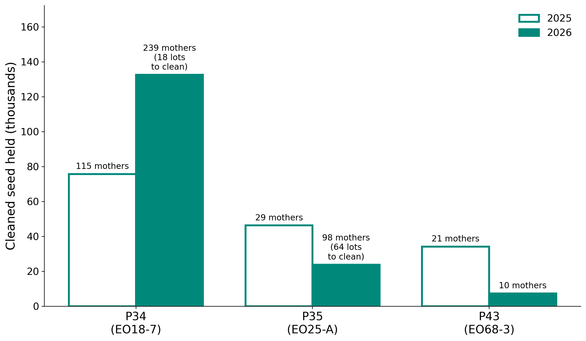

# Towards prioritising slickspot peppergrass populations for seed production

**What this document is.** The companion to the NCA Symposium talk
(15 minutes) and the source of its figures: which *Lepidium
papilliferum* populations meet the reproductive requirements for **seed
bulking**, based on field data (seed set for plant size) and the genetic
framework of [`Project_outline.md`](Project_outline.md). All figures are
in [`figures_seed_bulking/`](figures_seed_bulking/); the population table is
[`tables/step32_seed_bulking_populations.tsv`](tables/step32_seed_bulking_populations.tsv).

**Colours used throughout the talk.** Each population's reproductive
type has one colour on every figure and map, distinct from the
Bottleneck Lineage (BL) colours, which appear on maps as dashed outlines:

| Type | Colour | Meaning |
|---|---|---|
| **Mate-limited** | magenta `#C2185B` | sets less seed than its plants' size predicts (hollow = candidate) |
| **Reproductively intact** | teal `#00897B` | sets the seed its plants' size predicts |
| **Over-producing** | gold `#E6A100` | sets more seed than its size predicts — a possible sign of self-fertilisation (SI escape) |
| Not yet clear | grey `#9E9E9E` | switches between seasons |
| One season only | light grey `#D9D9D9` | seed data in a single season — more data required |

*Authors:* Sven Buerki, Peggy Martinez, Mathew Geisler, Sam Billingsley,
Isaac Carretero, Kylie Stear, Alex Scott, Jayden Yun, Elizabeth Berrier,
Ashley Zahurak & Ian Robertson.

---

## 1. Why seed bulking

Slickspot peppergrass is federally threatened and its seeds are a limited
resource. Seed bulking — collecting a small number of seeds from a target
population and growing them in a greenhouse to harvest a much larger
quantity — will supply a genetically informed breeding programme that
supports population restoration through seed translocation. The source
populations for bulking must meet specific reproductive and genetic
requirements; this document identifies them from field and genetic data.

---

## 2. What we know so far

Populations decline independently of habitat quality, which points to a
biological limit on reproduction. Our research shows that:

- **Populations cluster into two genetic groups**, Snake River Plain (SRP)
  and Jarbidge (JAR); this work covers SRP.
- **The landscape is heavily fragmented** — five fragments, the
  Bottleneck Lineages, across SRP (Figures 1 – 3).
- **The species is self-incompatible (SI)**, a trait under genetic
  control (the SRK gene): a plant can only be fertilised by a mate
  carrying different SRK alleles.
- **Some populations have escaped SI** and become self-compatible.
- **Populations have declined significantly** over the last 15 years.

**Figure 1.** The element occurrences (EOs) sampled across the Snake River Plain, sized by flowering plants (two-year average).

**Figure 2.** The five fragments (Bottleneck Lineages), with the shortest distance between them.

**Figure 3.** Every population at its real extent, coloured by BL, with EO outlines; inset: population size per BL. The EO map coloured by BL is [`EO_sampling_map_BL.png`](figures_seed_bulking/EO_sampling_map_BL.png); the fine-scale maps, one per BL, are kept locally (`./run_pipeline.sh talkmaps`).

---

## 3. Reproductive status of every population — seed set for plant size

**Approach.** Every plant whose seeds were collected is photographed
against a whiteboard with rulers to measure its crown and height
([Figure 4](#fig-4)), and its seeds are counted. Larger plants set more
seed. Across all **1 441 plants
measured in 2025 and 2026**, seed count rises with crown size along one
curve shared by all populations, so each plant has an expected seed set
for its size ([Figure 5](#fig-5)). A population whose plants set,
on average, significantly less seed than their size predicts is
**mate-limited**; significantly more, **over-producing**; neither,
**reproductively intact**.

**Only populations with two seasons of data are typed.** All plants
shape the curve, but a population is typed only if at least 3 of its
plants were measured in **both** 2025 and 2026, so that no call rests on
a single good or bad season. Seed set was 15 % lower in 2026 across
populations; the types allow for that shared drop. **11 populations**
qualify; the other **26 have one season of data and need more before
they can be typed** — they stay on every figure in light grey.

**Figure 4.** Plant size phenotyping in the field, 2026: a small, a medium and a large plant photographed against the measuring board (crown width and height on the rulers), with their crown size and seed count. All three set about the seed their size predicts. Photos with location metadata removed: `figures_seed_bulking/plant_photos/`.

**Figure 5.** Seeds per plant against plant size (crown diameter), 1 441 plants, both seasons; log scales. Teal band = as expected, between half (magenta line) and twice (gold line) the seed a plant of that size is expected to set — the colours of the three reproductive types used in the rest of the talk.

**Result — the 11 two-season populations.**

| Type | Populations (BL) |
|---|---|
| **Mate-limited** | P10 EO27-3 (BL1), P42 EO70 (BL5); candidates P6 EO67 (BL1), P36 EO25-B (BL3) |
| **Reproductively intact** | **P34** EO18-7 + EO18-8 (BL3), **P35** EO25-A (BL3), **P43** EO68-3 (BL5) |
| **Over-producing** | P2 EO30-1 (BL1), P37 EO38 (BL4) |
| Not yet clear | P16 EO27-1 (BL1), P19 EO8 (BL2) — switch between seasons |

Among the one-season populations, four show a strong seed shortfall
(P1 EO112, P4 EO30-3, P8 EO27, P32 EO24) and should be measured again
before they are typed.

**Figure 6.** Seed set relative to what plant size predicts, per population and season, allowing for the 2026 drop shared by all populations; 1 = as expected, dashed lines = half and twice. Circle = 2025, square = 2026; **filled = that season differs significantly from expectation** (false-discovery-corrected q < 0.05), open = not significant. P10 and P42 are significantly below expectation in both seasons; P2 and P37 significantly above in 2026 only; P6 and P36 (candidates) and the three intact populations are not significant in either season; P16 and P19 are significant in opposite directions. Bottom row: the 26 one-season populations.

**Figure 7.** Reproductive type of every population on the Snake River Plain, sized by flowering plants; dashed outlines = Bottleneck Lineages.

---

## 4. What seed set cannot tell us on its own

Seed set for plant size is a powerful first screen — it covers every
population, needs no lab work and flags where reproduction falls short.
But **seed yield also depends on resources**: water and soil conditions
in the slick spots, the weather of the season, herbivory, pollinator
visits and the condition of each plant. Our test already allows for
plant size (which partly reflects resources) and for the drop in 2026
shared by all populations, but not for conditions that differ from site
to site. A population on a dry site could set less seed for its size
without any shortage of mates; a well-watered one could hide a mild
shortage.

The seed-yield types are therefore **hypotheses about reproduction**.
To confirm that a population is mate-limited — that its plants lack
compatible mates — we need its **SRK genotypes**: a mate-limited
population should hold fewer SRK alleles, or alleles so unevenly shared
that each plant can mate with only part of the population.

---

## 5. A genetic example — P42 against P34

Two of the typed populations already have SRK genotypes: **P42**
(EO70), mate-limited in both seasons, and **P34** (EO18), reproductively
intact in both seasons ([Figure 8](#fig-8)).

- **SRK alleles (A).** P42's plants carry 6 SRK alleles, and two of them
  make up 97 % of all copies. P34's carry 7, more evenly shared: the two
  commonest make up 69 %.
- **Mates available (B).** Because most of P42's plants carry the same
  two alleles, a plant can mate, on average, with **53 %** of its
  population; in P34, with **67 %**. The two ranges do not overlap
  (P42 0.51 – 0.56, P34 0.61 – 0.72).
- **Seed set (C).** P42 sets about half the seed its plants' size
  predicts in both seasons; P34 sets the expected amount.

The genetics point to the same answer as the seed counts: **P42 is short
of compatible mates, P34 is not** — although P34's 67 % is itself below
the 78 % expected if its alleles were a random sample of the species, so
it too has lost diversity, just not enough to depress its seed set. This
is one pair — an example, not a
test across populations. P42's genotyped plants are mostly seedlings
from 10 wild mothers and P34's are 32 plants, and siblings are not yet
corrected for. The SRK genotyping of P34 planned for 2025 – 2026 seed
([`Sampling_design.md`](Sampling_design.md)) will extend this
comparison.

**Figure 8.** SRK genotypes of a mate-limited (P42, magenta) and a reproductively intact population (P34, teal). **A** — share of SRK allele copies per allele (letters; the same letter is the same allele in both); **B** — for each genotyped plant, the share of its population it can mate with under the self-incompatibility system, with the average; **C** — seed set relative to plant size per season (circle = 2025, square = 2026; filled = significantly different from expectation). Data: [`tables/step32_genetic_example_P42_P34.tsv`](tables/step32_genetic_example_P42_P34.tsv).

---

## 6. Model populations for seed bulking

**The reproductively intact populations are the candidate sources**:
they set the seed their size predicts in both seasons, so their seed is
neither limited by a lack of compatible mates nor inflated by possible
self-fertilisation. Of the 44 populations, 37 have seed set measured, 11
in both seasons, and 3 of those are reproductively intact
([Figure 9](#fig-9)).

**Figure 9.** From all populations to candidate sources for seed bulking. The two-season populations are split by reproductive type; genetic filters come next.

| Population | BL | Fertile plants (2025 / 2026) | Plants measured (2025 / 2026) | Seed set for size (2025 / 2026) | Mothers with seed (2025 / 2026) |
|---|:-:|:-:|:-:|:-:|:-:|
| **P34** (EO18-7 + EO18-8) | BL3 | 523 / 1 150 | 113 / 221 | 1.28 / 0.91 | 115 / 239 |
| **P35** (EO25-A) | BL3 | 113 / 887 | 29 / 34 | 1.44 / 0.86 | 29 / 98 |
| **P43** (EO68-3) | BL5 | 48 / 23 | 21 / 10 | 1.32 / 1.00 | 21 / 10 |

**Seed available for bulking.** All three hold cleaned seed from both
seasons — from about 7 000 (P43, 2026) to 130 000 seeds (P34, 2026) —
drawn from 10 to 239 mothers ([Figure 11](#fig-11)); 64 of P35's 98 lots
from 2026 still await cleaning, so its 2026 total will rise.

**Figure 10.** The three reproductively intact populations (teal) — candidate sources for seed bulking; other populations in grey; dashed outlines = Bottleneck Lineages.

**Figure 11.** Cleaned seed held per candidate population (open = 2025, filled = 2026), with the number of mothers collected and lots still to clean. Data: [`tables/step32_seed_available.tsv`](tables/step32_seed_available.tsv).

**What to keep in mind.**
- All three set slightly more seed than expected in 2025 and the
  expected amount in 2026; they are intact once the shared 2026 drop is
  allowed for. A third season (2027) would confirm it.
- Two of the three lie in BL3 and one in BL5; BL1, BL2 and BL4 have no
  intact two-season population yet. Covering every lineage will need more
  seasons of data for the one-season populations.
- P34 is also the large population of the SRK genotyping design
  ([`Sampling_design.md`](Sampling_design.md)), so its SRK diversity will
  be known.
- Next filters before bulking: SRK diversity, self-compatibility status
  and representation of each BL.

---

**Reproducing the figures.** `./run_pipeline.sh bulking` runs
`Scripts/step32_seed_bulking.py` (table and seed-by-size figures) and
`Scripts/step32_seed_bulking_maps.R` (maps); the background maps of § 2
come from `./run_pipeline.sh talkmaps`.
