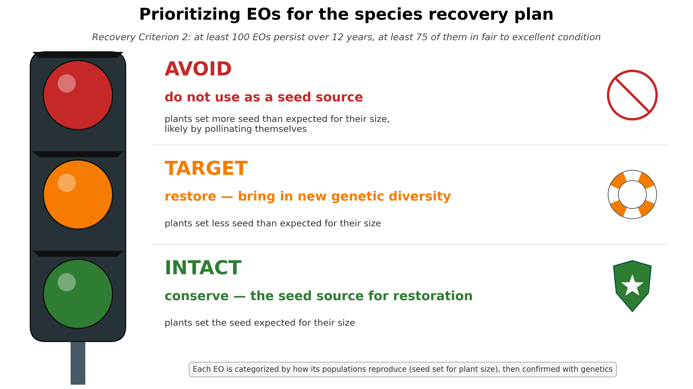
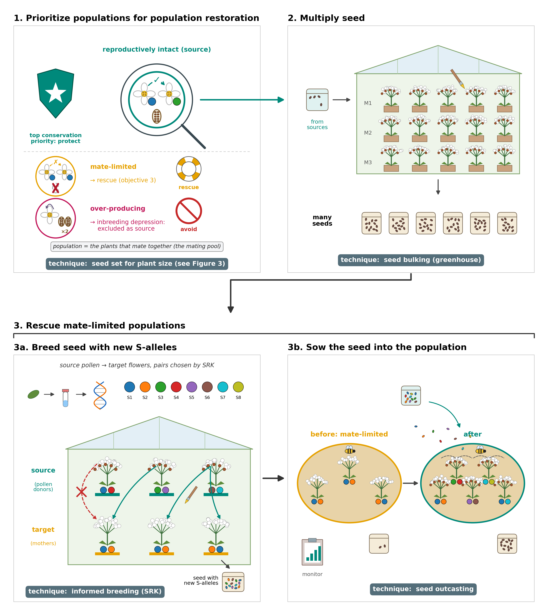
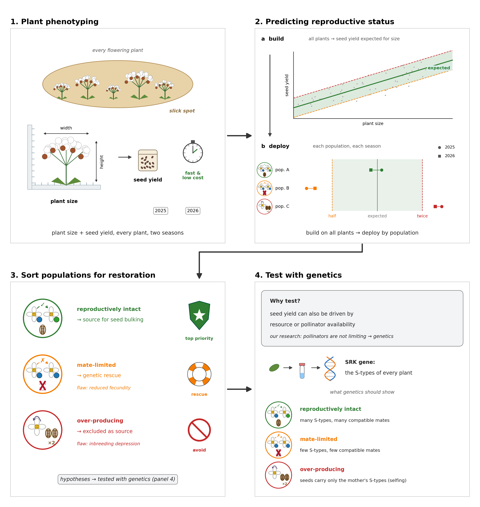
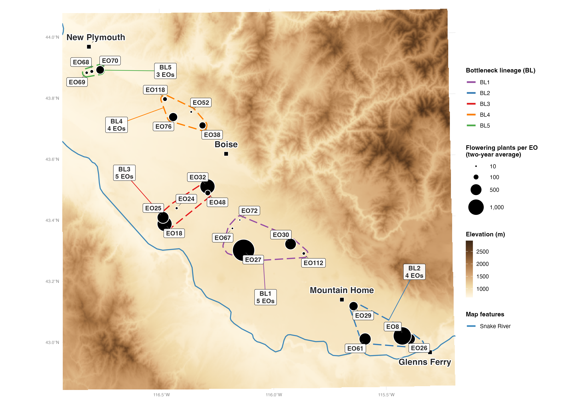
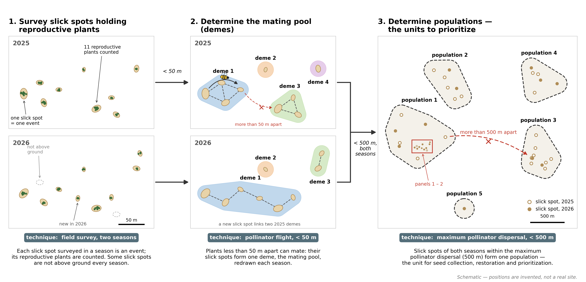
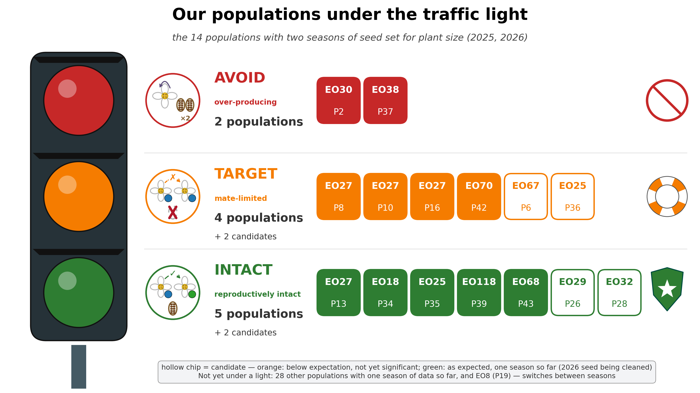

# Toward prioritizing slickspot peppergrass populations for seed production

**What this document is.** The companion to the NCA Symposium talk
(15 minutes) and the source of its figures: which *Lepidium
papilliferum* populations meet the reproductive requirements for **seed
bulking**, based on field data (seed set for plant size) and the genetic
framework of [`Project_outline.md`](Project_outline.md). All figures are
in [`figures_seed_bulking/`](figures_seed_bulking/); the population table is
[`tables/step32_seed_bulking_populations.tsv`](tables/step32_seed_bulking_populations.tsv).

> **Main result.** Of 44 populations, only **4 are reproductively intact
> over two seasons** — their seed set is significantly within half –
> twice what their plants' size predicts in both seasons — and qualify
> as sources for seed bulking: **P34** (EO18) and **P35** (EO25-A) in
> BL3, **P43** (EO68-3) in BL5 and **P13** (EO27-1) in BL1, covering
> three of the five lineages. Eleven more look intact but have a single
> season of data, so a second season could add sources, including the
> first for BL2 and BL4 (§ 7.3.2, § 7.5.2). All four still need the
> genetic filters (S-allele diversity, no self-compatible plants) before
> bulking. **Where SRK genotypes already exist, they mostly back the
> seed-set call:** P34 (32 genotyped plants) carries a balanced set of
> S-alleles, no self-compatible plants and more compatible mates than
> the mate-limited P42 (67 % against 53 %; § 7.4.2). P13 is the
> exception: its few genotyped plants (12) can mate with only 44 % of
> their population. On its two seasons of seed set it stays BL1's
> source, and more of its mothers will be genotyped (§ 7.4.2).

**Colors used throughout the talk.** Each population's reproductive
type is one light of a **traffic light** ([Figure 1](#fig-1)) and has one
color on every figure and map; the Bottleneck Lineages (BLs), the
landscape-management regions, have neutral colors (blues, purples,
slate) and appear on maps as dashed outlines:

| Category | Type | Color | Meaning |
|---|---|---|---|
| 🟢 **Intact** | **Reproductively intact** | green `#2E7D32` | sets the seed its plants' size predicts — conserve; seed source |
| 🟠 **Target** | **Mate-limited** | orange `#F57C00` | sets less seed than its plants' size predicts — restore by genetic rescue (hollow = candidate) |
| 🔴 **Avoid** | **Over-producing** | red `#C62828` | sets more seed than its size predicts — likely selfing (SI escape), inbreeding depression; excluded as a source |
| — | Not yet clear | gray `#9E9E9E` | switches between seasons |
| — | One season only | light gray `#D9D9D9` | seed data in a single season — more data required |

*Authors:* Sven Buerki, Peggy Martinez, Mathew Geisler, Sam Billingsley,
Isaac Carretero, Kylie Stear, Alex Scott, Jayden Yun, Elizabeth Berrier,
Ashley Zahurak & Ian Robertson.

**Contents.** [1. The goal: supporting the species recovery plan](#1-the-goal-supporting-the-species-recovery-plan) ·
[2. What we know so far](#2-what-we-know-so-far) ·
[3. How we deliver: objectives](#3-how-we-deliver-objectives) ·
[4. Our approach](#4-our-approach) ·
[5. What this document covers](#5-what-this-document-covers) ·
[6. Part 1 — Do EOs reflect populations?](#6-part-1--do-eos-reflect-populations) ·
[7. Part 2 — Prioritize populations for population restoration](#7-part-2--prioritize-populations-for-population-restoration) ·
[8. Conclusions](#8-conclusions) · [References](#references)

---

## 1. The goal: supporting the species recovery plan

**Goal.** To produce seed that supports the **species recovery plan**
for slickspot peppergrass ([USFWS, 2026](#ref-usfws2026)) — seed to
restore populations, toward the species' recovery and, in the long
term, its delisting under the U.S. Endangered Species Act.

**The target: Recovery Criterion 2.** The recovery plan sets three
criteria for delisting. Criterion 2 gives the number of EOs the species
needs ([USFWS, 2026](#ref-usfws2026), pp. 10 – 11):

> *"Slickspot peppergrass demonstrates improved resiliency and maintains
> range-wide redundancy as determined by the persistence of a minimum
> of 100 EOs across its range during a 12-year period, with at least 75
> EOs exhibiting fair to excellent viability (A-C rank) and the
> remainder of EOs exhibiting any condition of A through D."*

Of the 115 EOs documented today, 68 were ranked A – C in 2024, so
recovery requires keeping all of them and bringing **at least 7 more**
to a C rank or better — and the plan counts EOs "established by
out-planting or transplanting" toward this criterion. It asks that
conservation focus on "the 100 EOs that provide the best aggregate of
resiliency, redundancy, and representation", and its first-priority
actions include using genomics "to inform and prioritize slickspot
peppergrass EOs" (Recovery Action 7) and a secure stock of seed for
restoration (Criterion 3; Recovery Action 18).

**How we support Criterion 2: a traffic light for EOs.** To reach this
target, EOs must be prioritized: which to conserve, which to restore,
and which to keep out of restoration. We sort them with a **traffic
light** ([Figure 1](#fig-1)), read from the reproduction of the
populations each EO holds (§ 2):

- 🟢 **Intact** — **conserve**: the **seed source** for restoration.
  Plants set the seed expected for their size.
- 🟠 **Target** — **restore**, by bringing in new genetic diversity.
  Plants set less seed than expected for their size.
- 🔴 **Avoid** — **do not use as a seed source**. Plants set more seed
  than expected for their size, likely by pollinating themselves.

Which light a population falls under follows from the biology of the
species — its breeding system (§ 2), where these categories take their
biological names: *reproductively intact*, *mate-limited* and
*over-producing* (with inbreeding depression). It is read with a rapid
approach, seed set for plant size, and confirmed with genetics (§ 4).
An EO that holds populations under different lights (EO27, § 7.5.1) is
managed population by population (§ 6). The Bottleneck Lineages (BLs)
are secondary here: they are the **landscape-management regions** — the
recovery plan expects management to shift to these phylogenetic
groupings ([USFWS, 2026](#ref-usfws2026);
[Buerki et al., 2026](#ref-buerki2026)) — and they keep neutral colors
on every map, so they are never mistaken for a light.

**Figure 1.** The traffic light used to prioritize EOs for Recovery Criterion 2 of the species recovery plan ([USFWS, 2026](#ref-usfws2026)): at least 100 EOs persisting over 12 years, at least 75 of them in fair to excellent condition. **Red — avoid:** plants set more seed than expected for their size, likely by pollinating themselves; the EO's seed is not used for restoration (prohibition sign). **Orange — target:** plants set less seed than expected for their size; the EO is restored by bringing in new genetic diversity (ring buoy). **Green — intact:** plants set the seed expected for their size; the EO is conserved and is the seed source for restoration (shield). Each EO is categorized by how its populations reproduce (seed set for plant size) and then confirmed with genetics; the biology behind each light is in [Figure 2](#fig-2). The same colors and symbols are used on every later figure. Source: `Scripts/traffic_light_cartoon.py`.

**How we deliver on this promise.** The rest of this document shows how:
the challenge we face (below), the biology that places a population
under each light (§ 2), the program that turns the traffic light into
seed (§ 3) and the approach that sorts populations rapidly (§ 4).

**The challenge: very little seed.** Slickspot peppergrass is
federally threatened, and wild populations have limited fertility, so a
restoration program starts with very little seed. **Seed scarcity is
what impedes restoration:** there is far too little wild seed to restore
populations directly, and collecting more would deplete the populations
it comes from ([Figure 2](#fig-2), top). Why seed is so scarce, and why
populations differ in how much seed they set — the biology behind each
light — comes from the species' breeding system (§ 2).

---

## 2. What we know so far

Slickspot peppergrass is an allopolyploid (four copies of each
chromosome) whose populations are **declining and setting less seed**,
independently of habitat quality, which points to a biological limit on
reproduction ([Buerki et al., 2026](#ref-buerki2026)). Its breeding
system explains why ([Figure 2](#fig-2)):

1. **The species is self-incompatible (SI).** The S-locus — a male gene
   carried by the pollen (SCR) and a female gene on the stigma (SRK) —
   gives each plant an S-type, and pollen carrying the flower's own
   S-type is rejected: a plant can only be fertilized by a mate of a
   different S-type (panel 1). SI prevents selfing and protects the
   species from inbreeding.
2. **Habitat fragmentation drives genetic drift, which leads to mate
   limitation and population decline.** The species' range is split into isolated
   fragments — five on the Snake River Plain, the Bottleneck Lineages
   (§ 6.3). In small, isolated populations, genetic drift removes
   S-types, plants run out of compatible mates and set less seed than
   their size predicts — **mate limitation** (panel 2). Populations have
   declined significantly over the last 15 years (see references in
   [Buerki et al., 2026](#ref-buerki2026)).
3. **Some populations escaped SI and became self-compatible (SC)** —
   likely a rapid adaptation to the lack of mates. With their S-locus
   copies broken, plants accept their own pollen and set seed alone,
   more than their size predicts: a short-term gain (panel 3). Of 263
   LEPA plants genotyped at the S-locus, 247 are self-incompatible, 15
   have some copies broken and 1 is fully self-compatible. In the long
   term, selfing leads to **inbreeding depression** — offspring that are
   more alike and weaker, with less seed and lower survival — and again
   to population decline (panel 4).

The species also falls into two genetic groups, Snake River Plain (SRP)
and Jarbidge (JAR), which now define its management regions
([Buerki et al., 2026](#ref-buerki2026)); this work covers SRP.

**Figure 2.** The challenge and the breeding system behind it. **Top — the challenge:** the species is federally threatened and wild populations have limited fertility, so there is very little seed; far too little to restore populations directly, and collecting more would deplete the populations it comes from. **Below — why:** the breeding system of slickspot peppergrass and how it shapes populations. **1 — Self-incompatible breeding system**, under genetic control (DNA helix): the S-locus (combining a male and a female gene) gives each plant an S-type (color; 32 are known in LEPA); pollen with the flower's own S-type is rejected (no seed), pollen of another S-type is accepted (seed). **2 — Habitat fragmentation → genetic drift → mate limitation → population decline:** small, isolated populations lose S-types by drift, so plants find few compatible mates and set little seed. The badge in the corner (two flowers of the same S-type, pollen rejected, empty fruit) is the **mate-limited** badge used on every later figure (orange light of [Figure 1](#fig-1)). **3 — Rapid adaptation to mate limitation → increase in seed (short-term gain):** escape from self-incompatibility (tag *self-compatible*): plants whose S-locus copies are broken (LEPA has four copies of each chromosome; SI = working copies, SC = broken copies) accept their own pollen and set seed alone, without mates — at first, seed goes up (seed ↑); the pie chart gives the share of the 263 genotyped plants: 94% self-incompatible (247), 6% with some copies broken (15) and < 1% self-compatible (1). **4 — Long-term cost: inbreeding depression → population decline** (red tag *inbreeding depression*): selfed offspring are more alike and weaker, generation after generation (less seed, lower survival, lower genetic diversity and reproduction). The badge in the corner (a flower pollinating itself, extra fruit) is the **over-producing** badge used on every later figure (red light of [Figure 1](#fig-1)): populations that set more seed than their size predicts, likely by selfing, at the cost of inbreeding depression. Flower, pollen and fruit drawings from the breeding-system figures of the SRK genotyping pipeline ([SRK_bioinformatics](https://github.com/svenbuerki/SRK_bioinformatics)). Source: `Scripts/breeding_system_cartoon.py`; talk slides: `breeding_system_cartoon_slide1–3.png`.

**Three types of populations follow from the breeding system:**

- 🟢 **Reproductively intact** (*intact*) — enough S-types: the population sets the
  seed its plants' size predicts;
- 🟠 **Mate-limited** (*target*) — S-types lost: the population sets too little seed;
- 🔴 **Over-producing** (*avoid*) — plants have escaped self-incompatibility: the
  population sets too much seed, at the cost of inbreeding depression.

Each type is one light of the traffic light used to prioritize EOs (§ 1; [Figure 1](#fig-1)), and our approach
reads them from seed set in the field (§ 4).

---

## 3. How we deliver: objectives

**From the traffic light to seed.** Because wild seed is scarce (§ 1),
it cannot be sown directly: it must first be multiplied, then bred to
carry as much genetic diversity as possible. The program has three
objectives ([Figure 3](#fig-3)):

1. **Prioritize populations for population restoration** — find the
   reproductively intact populations that will be the seed sources, the
   mate-limited populations to rescue, and the populations under
   inbreeding depression, excluded as sources (panel 1).
2. **Multiply seed from the source populations** — seed bulking: a few
   seeds from each source are grown in a greenhouse to harvest a much
   larger quantity (panel 2).
3. **Rescue mate-limited populations** — informed breeding: source
   pollen is put on plants of the mate-limited population, pairs chosen
   by their SRK genotypes so that the seed carries new S-alleles
   (step 3a); that seed is then sown into the population by seed
   outcasting, and its plants find more compatible mates (step 3b).

Restoring reproduction in mate-limited populations is what the program
makes possible, not its justification: the program is needed because
there is too little seed.

**Why objective 1 comes first.** Seed bulking multiplies whatever a
source carries — its genetic diversity and its reproductive health, but
also its flaws. Sources must therefore be as close to ideal as possible:
reproductively intact, rich in S-alleles and free of self-compatible
plants. They are also the top conservation priority: losing a source
would compromise the whole program.

**Figure 3.** The population restoration program, with slickspot peppergrass as the model. Panel titles are the three **objectives** — objective 3, rescue mate-limited populations, in two steps (3a, 3b) — and the gray tags name the **technique** used. **1 — Prioritize populations for population restoration** (technique: seed set for plant size, our approach in [Figure 4](#fig-4)): the traffic light of [Figure 1](#fig-1) adapted to slickspot peppergrass — each light with its population type badge (as in [Figure 4](#fig-4) and Figures 10 – 13) and its biological name. **Red — avoid:** over-producing populations, under inbreeding depression, are excluded as seed sources (prohibition sign). **Orange — target:** mate-limited populations, with too few compatible mates, are rescued (objective 3; ring buoy). **Green — intact:** reproductively intact populations, with enough compatible mates, are the seed sources — their seed goes on to step 2 — and the top conservation priority (shield). The gray box at the foot of the panel defines the unit: a population is the plants that mate together (the mating pool). **2 — Multiply seed** from the sources (technique: seed bulking in the greenhouse, hand-crossed within each source, one row per mother). **3 — Rescue mate-limited populations**, which have limited genetic diversity and too few compatible mates, in two steps. **3a — Breed seed with new S-alleles** (technique: informed breeding — seedlings of the source (pollen donors, green) and of the target population (mothers, orange) are grown together in the greenhouse and genotyped at SRK, colored dots = S-alleles; source pollen is put on target flowers, pairs chosen so that they share no S-allele — a source plant sharing S1 with the targets is not used; the seed, harvested from the target mothers, carries new S-alleles). **3b — Sow the seed into the population** (technique: seed outcasting — the bred seed is sown into the mate-limited population; new S-alleles give its plants more compatible mates and seed set recovers; seed set and S-alleles are monitored). Plants and alleles are invented. Source: `Scripts/restoration_program_cartoon.py`; one frame per part for slides: `restoration_program_cartoon_step1–3.png`; landscape slides `restoration_program_cartoon_slide1` (objectives 1 – 2) and `_slide2` (objective 3: 3a, 3b); for the talk, the three types aligned: `_types`, then `_types_use`. The challenge is drawn in [Figure 2](#fig-2). The previous version of this figure is kept (`Scripts/restoration_cartoon.py`, `restoration_cartoon.png`).

---

## 4. Our approach

To meet objective 1, we need to sort populations **rapidly**, across every population,
against specific reproductive and genetic requirements. Genotyping every
population is slow and costly; our approach is fast and low cost, using
what is measured on every plant anyway — **seed yield for plant size** —
in four steps ([Figure 4](#fig-4)):

1. **Plant phenotyping** — plant size and seed yield of every flowering
   plant, in two seasons;
2. **Predicting reproductive status** — build the model of seed yield
   expected for plant size on all plants, then deploy it population by
   population;
3. **Sort populations for restoration** — sources, populations to
   rescue and populations excluded as sources;
4. **Test with genetics** — the sort gives hypotheses: seed set shows how
   a population reproduces, not why. Plant size and seed yield can also
   be driven by resource or pollinator availability; our research shows
   that pollinators are not limiting, so the remaining question is
   genetic. Each call is tested by **SRK
   genotyping** (S-allele diversity, share of compatible mates,
   self-compatible plants), so genotyping is spent only on the
   populations that matter — sources and rescue targets first (§ 7).

**Figure 4.** Our approach to sort populations for population restoration — the technique of step 1 in [Figure 3](#fig-3). **1 — Plant phenotyping:** the plant size (crown width and height) and seed yield of every flowering plant of each slick spot are measured in two seasons: fast and low cost, no genotyping. **2 — Predicting reproductive status:** (a) *build* — all plants together give the seed yield a plant of a given size is expected to set (green line; band from half, orange, to twice, red); (b) *deploy* — the model is applied to each population and season: its seed yield relative to what its plants' size predicts (circle = 2025, square = 2026); the badge next to each population gives the type it is sorted into in panel 3. **3 — Sort populations for restoration** (one type badge per row, as in [Figure 3](#fig-3)): reproductively intact populations (as expected) are the sources for seed bulking and the top conservation priority; mate-limited populations (below) are the targets of genetic rescue — their flaw is reduced fecundity; over-producing populations (above) are excluded as sources — their flaw is inbreeding depression; the symbols on the right give the action for each type (shield = top priority, ring buoy = rescue, prohibition sign = avoid, as in [Figure 3](#fig-3)). **This sort is a set of hypotheses** (banner at the foot of panel 3): plant size and seed yield can also be driven by resource or pollinator availability — our research shows pollinators are not limiting, which is why we focus on genetics — and phenotyping and prediction say how a population behaves, not why, so each type is tested with genetics — the SRK gene (S-types) gives the S-allele diversity, the share of compatible mates and any selfing. Plants and values are invented. Source: `Scripts/source_screening_cartoon.py`; landscape version for slides `source_screening_cartoon.png`, one frame per step: `source_screening_cartoon_step1–2.png`.

---

## 5. What this document covers

This document addresses **objective 1 — prioritize populations for
population restoration** — with the approach of [Figure 4](#fig-4), in
two parts:

1. **Do EOs reflect populations?** (§ 6) — a prerequisite: restoration
   works on populations, the plants that mate together — the unit that
   is prioritized, the source of the seed and the target that receives
   it. Our records are organized by element occurrence (EO), the unit of
   landscape management. We build populations from the slick spots,
   independently of the EOs, and test whether the two align — and, where
   they do not, how they compare.
2. **Prioritize populations** (§ 7) — the approach applied to every
   population: which are reproductively intact (sources), mate-limited
   (to rescue) or over-producing (excluded as sources).

Each part is presented as approach, methods, results and discussion
(Part 2 adds a validation with genetics before its discussion, § 7.4);
§ 8 summarizes the outcome of each part and what to do next.

### 5.1 Materials (both parts)

Both parts rest on the same field data, from the LEPA database: every
slick spot holding reproductive plants surveyed in 2025 and 2026 on the
Snake River Plain. Part 1 uses the slick spots and their plant counts;
Part 2 uses the plants measured for size and seed yield.

| | 2025 | 2026 | Both seasons |
|---|:-:|:-:|:-:|
| Element occurrences (EOs) | 19 | 19 | 21 |
| Locations (survey sites) | 39 | 43 | 52 |
| Slick spots surveyed (events) | 237 | 486 | 723 |
| Reproductive plants counted | 5 687 | 10 344 | 16 031 |
| Plants measured for size and seed yield | 741 | 847 | 1 588 |

An EO can hold several locations; a slick spot surveyed in both seasons
counts once per season. Source:
[`tables/step32_materials_by_season.tsv`](tables/step32_materials_by_season.tsv).

**Where the data come from.** The 21 EOs range from a handful of
flowering plants to several hundred ([Figure 5](#fig-5)).

**Figure 5.** The element occurrences (EOs) sampled across the Snake River Plain, sized by flowering plants (two-year average), within the five bottleneck lineages (BLs; dashed outlines, each labeled with its number of EOs).

**Five lineages.** The EOs fall into five fragments of the landscape,
the **Bottleneck Lineages** (BL1 – BL5), separated by gaps too wide for
pollinators or seed to cross ([Figure 6](#fig-6)); each lineage evolves
largely on its own, so a lineage that loses diversity cannot regain it
from its neighbors.

**Figure 6.** The five fragments (Bottleneck Lineages), with the shortest distance between them.

---

## 6. Part 1 — Do EOs reflect populations?

### 6.1 Approach

Restoration needs **populations**: groups of plants that exchange
pollen and seed — the mating pool — separate enough from the next
population to be treated as a source or a target on their own. Our
records, like the species' management, are organized by **element
occurrence (EO)**, the unit drawn to track where the species occurs and
to manage the landscape. So we ask: **do EOs reflect populations?**
To answer, we build populations from the ground up — from the slick
spots, with rules set by pollinator flight and blind to EO boundaries —
then compare them with the EOs. Pollinator flight sets the mating
unit, the **deme**; the **population** groups the slick spots that stay
together across seasons ([Figure 7](#fig-7)).

### 6.2 Methods

Every slick spot surveyed in a season is an **event**, and its
reproductive plants are counted (materials in § 5.1). Within a season, slick spots less than
**50 m** apart (pollinator flight) are linked, and each connected group
is a **deme**, the group of plants that actually mate with each other;
a slick spot on its own is a deme by itself. Slick spots of all seasons
(so far 2025 and 2026) less than **500 m** apart are linked into one
**population** — the maximum pollinator dispersal, so that pollen and
seed rarely move between populations — inside which demes are redrawn each
season. The rules are applied to every slick spot surveyed in 2025 and
2026 in the LEPA database (`./run_pipeline.sh units`). We then compare
each EO with the populations its slick spots fall into: one EO holding
exactly one population means the two align.

**Figure 7.** Slick spot (event) → deme → population. **1 — Survey slick spots holding reproductive plants** (technique: field survey, two seasons): the same ground in 2025 (top) and 2026 (bottom); each slick spot surveyed in a season is an event, and its reproductive (flowering) plants are counted; some slick spots are not above ground in a season (dashed), others appear. **2 — Determine the mating pool (demes)** (technique: pollinator flight, < 50 m, each season): plants on slick spots less than 50 m apart can mate, so these slick spots form one deme; a slick spot on its own is a deme by itself. Demes are redrawn every season: here a new 2026 slick spot links two 2025 demes. **3 — Determine populations, the units to prioritize** (technique: maximum pollinator dispersal, < 500 m): slick spots of both seasons (open = 2025, filled = 2026) less than 500 m apart form one population — the unit for seed collection, restoration and prioritization; slick spots more than 500 m apart (red ✗) belong to different populations; the red box marks where the close-up of panels 1 – 2 lies. Positions are invented. Source: `Scripts/units_cartoon.py` (landscape version for slides; the portrait version, `units_cartoon.png`, is used in the project outline and sampling design).

### 6.3 Results

**Demes and populations.** The rules give **99 demes in 2025 and 189 in
2026** — the mating pools, redrawn each season (more slick spots were
surveyed in 2026) — and **44 populations** over the two seasons (33
above ground in 2025, 37 in 2026, 26 in both), structured within the
five Bottleneck Lineages ([Figure 6](#fig-6)). Populations per lineage
([Figure 8](#fig-8)):

| Lineage | EOs | Populations | Present in both seasons |
|---|:-:|:-:|:-:|
| BL1 | 5 | 17 | 6 |
| BL2 | 4 | 9 | 7 |
| BL3 | 5 | 10 | 7 |
| BL4 | 4 | 5 | 4 |
| BL5 | 3 | 3 | 2 |
| **Total** | **21** | **44** | **26** |

BL1 holds the most populations but the smallest share present in both
seasons (6 of 17); across all lineages, 18 populations were above ground in
only one of the two seasons.

**Do EOs reflect populations? Three results.**

1. **EOs respect populations: none of our 44 populations crosses an EO
   boundary.** Every population lies within a single EO, so the two are
   **nested**. This is a real test: populations are built from all slick
   spots together, without reference to EOs, so a population would join
   two EOs wherever their slick spots came within 500 m. They never do —
   the closest slick spots of two different EOs (EO8 and EO26) are
   1.1 km apart, and the next closest pair (EO18 and EO25) 1.25 km.
2. **Most EOs are one population: 13 of the 21 EOs we sampled hold a
   single population.** In these EOs, the EO and the population align.
3. **Some EOs hold many: the other 8 EOs hold 31 populations, and EO27
   alone holds 10** (EO26 five, EO24 and EO30 four, EO8, EO25, EO32 and
   EO76 two each).

| EOs | Populations per EO | Populations |
|---|---|:-:|
| 13 | one — EO and population align | 13 |
| 4 | two (EO8, EO25, EO32, EO76) | 8 |
| 2 | four (EO24, EO30) | 8 |
| 1 | five (EO26) | 5 |
| 1 | ten (EO27) | 10 |
| **21** | | **44** |

Within EOs, four populations join two parts of the same EO
(P34 = EO18-7 + EO18-8; P16 = EO27-1 + EO27RT; P21 and P22 each join a
part of EO26 with EO26 itself), so EO parts do not always mark separate
populations either.

**Figure 8.** Every population at its real extent, colored by BL, with EO outlines; each BL is labeled with its number of EOs and populations (all populations seen over the two seasons, 44 in total); inset: population size per BL. The EO map colored by BL is [`EO_sampling_map_BL.png`](figures_seed_bulking/EO_sampling_map_BL.png); the fine-scale maps, one per BL, are kept locally (`./run_pipeline.sh talkmaps`).

### 6.4 Discussion

- **EOs are a sound frame for populations.** Because no population
  crosses an EO boundary (result 1), every population can be placed in
  one EO, and the EO remains the frame for landscape management. Where
  an EO holds one population (result 2), it can be managed, sampled and
  restored as that population.
- **Where they differ, the EO is the coarser unit** (result 3). This is
  expected: EOs are drawn to track where the species occurs and to manage
  the landscape, while populations follow pollen movement (§ 6.2). Mate
  limitation and genetic rescue act on the plants that mate together, so
  in the 8 EOs that hold several populations — 31 of the 44 —
  **seed sourcing and rescue must work at the population level, inside
  the EO frame.** Part 2 shows why this matters: populations within one
  EO can differ in reproductive type (EO27, § 7.5.1).
- **Demes are the unit of mating.** They set how many mothers to sample
  within a population for SRK genotyping
  ([`Sampling_design.md`](Sampling_design.md)).
- **Many populations are seen in one season only** (18 of 44), because
  plants are not above ground every year. A population needs two
  seasons of data before its reproductive type can be called (§ 7.2), so
  the one-season populations are the first place where more data will
  add candidate sources.

---

## 7. Part 2 — Prioritize populations for population restoration

### 7.1 Approach

The **reproductively intact populations are the candidate sources**:
they set the seed their plants' size predicts, so their seed is neither
limited by a lack of compatible mates nor inflated by possible
self-fertilization. A population whose plants set, on average,
significantly less seed than their size predicts is **mate-limited**;
significantly more, **over-producing**; significantly within half –
twice of it, **reproductively intact** ([Figure 4](#fig-4)). These seed-set types are hypotheses about
reproduction; SRK genotypes, where they exist, are the genetic check.

### 7.2 Methods

**Plant size and seed.** Every plant whose seeds were collected is
photographed against a whiteboard with rulers to measure its crown and
height, and its seeds are cleaned, weighed and converted to a seed count
([Figure 9](#fig-9)). Larger plants set
more seed. Across all **1 588 plants measured in 2025 and 2026** (§ 5.1), seed
count rises with crown size along one curve shared by all populations,
so each plant has an expected seed set for its size
([Figure 10](#fig-10)).

**Figure 9.** Plant phenotyping. **Plant size (field, top), 2026:** a small, a medium and a large plant photographed against the measuring board (crown width and height on the rulers), with their crown size as written on the field board (6, 13 and 30 cm) and the seed a plant of that size is expected to set (the green line of [Figure 10](#fig-10)): about 150, 390 and 1 110 seeds. All three set about the seed their size predicts. **Seed yield (lab, bottom):** each plant's fruits are cleaned by hand at the bench (left), separating the seed (lower pile) from the chaff (upper pile; right); the cleaned seed is weighed to 0.1 mg (inset) and the weight is converted to a seed count with the linear model of the LEPA database (boxed legend): seeds = (weight − 0.37 mg) ÷ 0.425 mg (about 2.4 seeds per mg; 95 % prediction interval ± 45 seeds). Photos with location metadata removed: `figures_seed_bulking/plant_photos/`.

**Figure 10.** Seeds per plant against plant size (crown diameter), 1 588 plants, both seasons; log scales. Green line = the seed a plant of that size is expected to set (the relationship shared by all populations); green band = as expected, between half (orange line) and twice (red line) that seed — the colors of the three reproductive types used in the rest of the talk. Icons: over-producing (red — a flower pollinating itself, extra fruit) above the red line; mate-limited (orange — two flowers of the same S-type, pollen rejected, empty fruit) below the orange line.

**Only populations with two seasons of data are typed.** All plants
shape the curve, but a population is typed only if at least 3 of its
plants were measured in **both** 2025 and 2026, so that no call rests on
a single good or bad season. Seed set was 10 % lower in 2026 across
populations; the types allow for that shared drop. Each season is
tested twice, with a false-discovery correction (q < 0.05): does seed
set **differ** from expectation (below = mate-limited, above =
over-producing), and is it significantly **within** half – twice the
expectation (an equivalence test, two one-sided t-tests)? The second
test makes "reproductively intact" a positive result rather than the
absence of a significant difference. A population is a mate-limited
**candidate** when its seed set trends below expectation (under 0.8 in
a season) but neither test is conclusive.

**Genetic check.** Where a population's plants are genotyped at SRK
(the Canu-amplicon pipeline of
[SRK_bioinformatics](https://github.com/svenbuerki/SRK_bioinformatics)),
its S-alleles and the share of the population each plant can mate
with under the self-incompatibility system are compared with its
seed-set type.

`./run_pipeline.sh bulking` runs `Scripts/step32_seed_bulking.py`
(table and seed-by-size figures) and `Scripts/step32_seed_bulking_maps.R`
(maps).

### 7.3 Results

#### 7.3.1 Reproductive type of every population

**44 populations** in all: **13 have two seasons of seed data and are
typed** ([Figure 12](#fig-12)); the other **31 have one season of data** — 25 with seed data
from that season and 6 seen only in 2026 whose seed has no data yet.
One season gives a **candidate** type only, to be confirmed by a second
season; one-season populations stay on every figure in light gray.

| Type | Two seasons (typed) | One season (candidates) | Total |
|---|---|---|:-:|
| **Reproductively intact** | 4: **P13** EO27-1 (BL1), **P34** EO18-7 + EO18-8 (BL3), **P35** EO25-A (BL3), **P43** EO68-3 (BL5) | 11: **P26\*** EO29 (BL2), **P28\*** EO32 (BL3), **P39\*** EO118 (BL4); P5 EO30-2 (BL1), P9 EO27 (BL1), P21 EO26 + EO26-3 (BL2), P22 EO26 + EO26-4 (BL2), P27 EO48 (BL3), P30 EO24-7 (BL3), P38 EO52 (BL4), P41 EO76 (BL4) | 15 |
| **Mate-limited** | 6: P8 EO27 (BL1), P10 EO27-3 (BL1), P16 EO27-1 + EO27RT (BL1), P42 EO70 (BL5); candidates P6 EO67 (BL1), P36 EO25-B (BL3) | 5: P1 EO112 (BL1), P4 EO30-3 (BL1), P32 EO24 (BL3); not significant: P3 EO30-4 (BL1), P20 EO26-2 (BL2) | 11 |
| **Over-producing** | 2: P2 EO30-1 (BL1), P37 EO38 (BL4) | 5: P18 EO8, P23 EO26-3, P24 EO26-1, P25 EO61 (all BL2), P40 EO76 (BL4) | 7 |
| Not yet clear | 1: P19 EO8 (BL2) — significantly above expectation in 2025, below in 2026 | — | 1 |
| Not typed yet | — | 10: P7 EO72-2 (BL1), P29 EO32 (BL3), P31 EO24-1 (BL3), P33 EO24-2 (BL3) — too few plants or not conclusive; no seed data yet: P11, P12, P14, P15, P17 (EO27, BL1), P44 EO69 (BL5) | 10 |
| **Total** | **13** | **31** | **44** |

\* 2026 seed being cleaned, and 2025 seed set significantly within half –
twice the expectation: these three can be confirmed as sources first
(green rings in [Figure 13](#fig-13); § 7.5.3). Among the one-season
mate-limited candidates, P1, P4 and P32 show a strong seed shortfall
and should be measured again before they are typed
([Figure 11](#fig-11), [Figure 13](#fig-13)).

**Mate limitation is concentrated in EO27.** Three of the four
confirmed mate-limited populations — P8, P10 and P16 — lie in one EO,
EO27 (BL1); the fourth, P42, is in BL5. EO27 also holds P13, BL1's
only reproductively intact population (§ 7.5.1).

**Figure 11.** Seed set relative to what plant size predicts, per population and season, allowing for the 2026 drop shared by all populations; 1 = as expected, dashed lines = half and twice. Circle = 2025, square = 2026; **filled = that season differs significantly from expectation** (false-discovery-corrected q < 0.05), open = not significant. P10 and P42 are significantly below expectation in both seasons, P8 and P16 in 2025; P2 and P37 significantly above in 2026 only; the four intact populations (P13, P34, P35, P43) are significantly within half – twice in both seasons (filled green); P6 and P36 (candidates) are not significant either way; P19 is significant in opposite directions. Bottom row: the 25 one-season populations. Icons above the headers: mate-limited (two flowers of the same S-type, pollen rejected, empty fruit), as expected (two flowers of different S-types, pollen accepted, full fruit) and over-producing (a flower pollinating itself, extra fruit) — the breeding-system logic of [Figure 2](#fig-2).

**Figure 12.** Our populations under the traffic light of [Figure 1](#fig-1): the 13 populations with two seasons of seed set for plant size (2025, 2026), each as a chip with its EO. **Red — avoid** (over-producing): P2 and P37. **Orange — target** (mate-limited): P8, P10 and P16 — all three in EO27 — and P42; hollow chips are candidates, below expectation but not significantly in either season (P6, P36). **Green — intact** (reproductively intact): P13, P34, P35 and P43, the seed sources. Gray box: populations not yet under a light — 31 with one season of data so far (the likely sources P26, P28 and P39 are being confirmed with their 2026 seed; § 7.5.3) and P19, which switches between seasons. Badges and symbols as in Figures 1 – 4. Source: `Scripts/traffic_light_results.py` (from `tables/step32_seed_bulking_populations.tsv`, so it follows the data).

**Figure 13.** Reproductive type of every population on the Snake River Plain (all 44; one season only = seen or measured in a single season, including 6 seen in 2026 whose seed has no data yet), sized by flowering plants; **green ring = candidate source**: one season so far, its 2025 seed set significantly within half – twice the expectation, and its 2026 seed being cleaned — P39 (BL4) and P28 (BL3), the two locations being cleaned first, and P26 (BL2, borderline; § 7.5.3); dashed outlines = Bottleneck Lineages. Inset, top: the reproductive-type icons of [Figures 10](#fig-10) and [11](#fig-11). Inset, right (under the icons): zoom on EO27 (box on the map; dashed outline = the EO) — one EO holding ten populations, each as a polygon (its slick spots, buffered 60 m) colored by its type: BL1's source P13 (green) next to the mate-limited P8, P10 and P16 (orange), and six populations with one season only (gray): P9 and P11, P12, P14, P15, P17, seen in 2026 with no seed data yet; an EO that holds several populations, so restoration works on the populations within it (§ 6.4). Smaller populations are drawn on top, so P13 shows over the larger P16 at EO27-1.

#### 7.3.2 Candidate sources for seed bulking

Of the 44 populations, 38 have seed set measured, 13 in both seasons,
and 4 of those are reproductively intact ([Figure 14](#fig-14),
[Figure 15](#fig-15)).

**Figure 14.** From all populations to candidate sources for seed bulking. The two-season populations are split by reproductive type; genetic filters come next.

| Population | BL | Fertile plants (2025 / 2026) | Plants measured (2025 / 2026) | Seed set for size (2025 / 2026) | Mothers with seed (2025 / 2026) |
|---|:-:|:-:|:-:|:-:|:-:|
| **P13** (EO27-1) | BL1 | 395 / 191 | 24 / 38 | 0.81 / 1.13 | 26 / 38 |
| **P34** (EO18-7 + EO18-8) | BL3 | 523 / 1 150 | 113 / 239 | 1.20 / 0.98 | 115 / 239 |
| **P35** (EO25-A) | BL3 | 113 / 887 | 29 / 38 | 1.29 / 0.89 | 29 / 98 |
| **P43** (EO68-3) | BL5 | 48 / 23 | 21 / 10 | 1.18 / 1.03 | 21 / 10 |

**Figure 15.** The four reproductively intact populations (green) — candidate sources for seed bulking; other populations in gray; dashed outlines = Bottleneck Lineages.

**What to keep in mind.**
- All four are significantly within half – twice the expected seed set in
  both seasons. P34, P35 and P43 set slightly more than expected in 2025
  and the expected amount in 2026; P13 slightly less in 2025 (0.79) and
  slightly more in 2026. A third season (2027) would confirm them.
- Two lie in BL3, one in BL5 and one in BL1; BL2 and BL4 have no intact
  two-season population yet. Covering every lineage will need more
  seasons of data for the one-season populations.
- **P13 is BL1's source; its genetics need a closer look.** Its seed set
  is as expected in both seasons, but its few genotyped plants have the
  lowest compatibility of any genotyped site, so more of its mothers
  will be genotyped (§ 7.4.2).
- P34 is also the large population of the SRK genotyping design
  ([`Sampling_design.md`](Sampling_design.md)), so its S-allele diversity will
  be known.
- Next filters before bulking: S-allele diversity, self-compatibility status
  and representation of each BL.

### 7.4 Validation with genetics

The traffic light of [Figure 12](#fig-12) is built from seed set for
plant size, so each light is a **hypothesis about reproduction**, not
yet a fact. Before seed is moved, every light has to be tested with
genetics.

#### 7.4.1 Why the lights must be tested

**Resource or pollinator availability could bias our hypotheses.**
Seed set for plant size is a powerful first screen — it covers every
population, needs no lab work and flags where reproduction falls short.
But **seed yield also depends on resources**: water and soil conditions
in the slick spots, the weather of the season, herbivory, pollinator
visits and the condition of each plant. Of these, pollinator
availability is the one that could mimic mate limitation, but our
research shows that pollinators are not limiting, which is why we
focus on genetics. Our test already allows for
plant size (which partly reflects resources) and for the drop in 2026
shared by all populations, but not for conditions that differ from site
to site. A population on a dry site could set less seed for its size
without any shortage of mates; a well-watered one could hide a mild
shortage.

The seed-yield types are therefore **hypotheses about reproduction**.
To confirm that a population is mate-limited — that its plants lack
compatible mates — we need its **SRK genotypes**: a mate-limited
population should hold fewer S-alleles, or alleles so unevenly shared
that each plant can mate with only part of the population. Where they
already exist, they mostly agree with seed set; P13 is the exception
(§ 7.4.2). The equivalence test strengthens the intact call — it shows
that seed set is within the expected range, not merely that no
shortfall was detected — but it cannot rule out a site whose resources
mask a shortage of mates.

#### 7.4.2 Preliminary results — P42 against P34, and P13

Two of the typed populations already have SRK genotypes: **P42**
(EO70), mate-limited in both seasons, and **P34** (EO18), reproductively
intact in both seasons ([Figure 16](#fig-16)).

Seed set for plant size already typed them: P42 sets about half the
seed its plants' size predicts in both seasons, P34 the expected amount
([Figure 11](#fig-11)).

- **SRK genotypes (panel 1).** The two populations hold a similar number of
  S-types (S-alleles): 6 in P42 and 7 in P34. What differs is **how
  they are arranged across plants**. In P42, most plants carry only one
  or both of the same two S-types, so three S-type sets make up 93 % of
  its 74 plants; in P34 the plants carry more varied sets (the three
  commonest make up 66 % of its 32 plants).
- **Random mating → compatible mates (panel 2).** Under self-incompatibility, a
  plant rejects pollen from a father that shares its S-type. Mating at
  random within its population, a P42 plant can therefore mate, on
  average, with only **53 %** of its population; a P34 plant with
  **67 %**. The two ranges do not overlap (P42 0.51 – 0.56, P34
  0.61 – 0.72).

The genetics point to the same answer as seed set for plant size: **P42 is short
of compatible mates, P34 is not** — although P34's 67 % is itself below
the 78 % expected if its alleles were a random sample of the species, so
it too has lost diversity, just not enough to depress its seed set. This
is one pair — an example, not a
test across populations. P42's genotyped plants are mostly seedlings
from 10 wild mothers and P34's are 32 plants, and siblings are not yet
corrected for. The SRK genotyping of P34 planned for 2025 – 2026 seed
([`Sampling_design.md`](Sampling_design.md)) will extend this
comparison.

**Figure 16.** Same S-allele diversity, different arrangement: SRK genotypes of a mate-limited (P42, orange) and a reproductively intact population (P34, green), with their type badges. **1** — every genotyped plant as a square, its 4 dots its 4 SRK copies (tetraploid), one color per S-type as in [Figure 2](#fig-2) (the same color is the same S-type in both); plants are grouped by the set of S-types they carry, commonest set first. Both hold 6 – 7 S-types, but in P42 the same few sets repeat from plant to plant (3 sets = 93 % of plants; P34: 66 %; written under each population's plants). **Arrow — random mating** (bee: pollinators carry pollen between plants at random): each plant meets fathers from its own population, and a father sharing an S-type is rejected. **2** — the result: for each genotyped plant, the share of its population it can mate with under the self-incompatibility system; bar = average (P42 53 %, P34 67 %). Badges with **✓ confirmed**: the genetics agrees with the type called from seed set for plant size (phenotyping) for both populations. Data: [`tables/step32_genetic_example_P42_P34.tsv`](tables/step32_genetic_example_P42_P34.tsv). Talk build-up: `genetic_example_P42_P34_step1` (S-types and plants per population), `_step2` (+ genotypes and the 3 commonest sets), then the whole figure.

**P13: intact by seed set, at odds with its genetics — the exception.** Its seed set
is significantly within half – twice the expectation in both seasons
(0.81 in 2025, 1.13 in 2026), so by seed set it is reproductively intact
— BL1's only source. But its genotyped plants have the lowest
compatibility of any genotyped site: a plant can mate with only about
44 % of its population (P42: 53 %, P34: 67 %), with 5 S-alleles and
almost no Class I alleles. That rests on 12 plants from 7 mothers, so it
is indicative. We keep P13 as BL1's source on its seed set; as it
enters seed bulking, more of its mothers will be genotyped — seed–mother
genotyping would show whether its plants find compatible mates — and
its 2027 seed set adds a third season.

#### 7.4.3 Populations still to test

Two of the three genotyped populations agree with their light (P42,
P34) and the third (P13) does not, so every other light must be tested
too — sources first, because they carry the restoration:

- 🟢 **Sources (intact).** **P34** — SRK genotyping of its 2025 – 2026
  seed is under way ([`Sampling_design.md`](Sampling_design.md));
  **P35** and **P43** — not yet genotyped; **P13** — more of its mothers
  (§ 7.4.2). Each source also needs the genetic filters: enough
  S-allele diversity, no self-compatible plants and, ideally, one
  source per lineage.
- 🟠 **Targets (mate-limited).** **P8, P10 and P16** in EO27 first, then
  the candidates **P6** and **P36**: genotyping confirms the shortage
  of compatible mates and shows which S-alleles each lacks, so that the
  source pollen brings new ones (P42 is already confirmed).
- 🔴 **Avoid (over-producing).** **P2** and **P37**: seed–mother
  genotyping tests the selfing call directly — seedlings of a selfing
  mother carry only her own S-alleles.
- ⚪ **One season so far.** The likely sources **P26, P28 and P39** get
  their second season first (§ 7.5.3), then their genetics; the other
  one-season populations keep their place in the table only
  provisionally.

---

### 7.5 Discussion

#### 7.5.1 Populations that need our attention — BL1 and EO27

**BL1 has one source, P13.** BL1, the largest lineage
(17 populations), has six populations measured in both seasons, and
one of them — P13 — is reproductively intact:

| Population | EO | Type (two seasons) | Seed set for size, 2025 / 2026 |
|---|---|---|---|
| P10 | EO27-3 | **mate-limited** — significant in both seasons | 0.43 / 0.03 |
| P16 | EO27-1 + EO27RT | **mate-limited** — significant in 2025 | 0.37 / 1.15 |
| P8 | EO27 | **mate-limited** — significant in 2025 | 0.42 / 0.86 |
| P13 | EO27-1 | **reproductively intact** — within half – twice in both seasons | 0.81 / 1.13 |
| P6 | EO67 | mate-limited (candidate) — not significant in either season | 0.52 / 0.56 |
| P2 | EO30-1 | **over-producing** — significant in 2026 | 0.90 / 1.62 |

**EO27 stands out.** It holds ten populations; five have seed data so
far (the other five, seen in 2026, have none yet). Three of these five set significantly
less seed than their size predicts: P10 (EO27-3) in both seasons, and
P16 (EO27-1 + EO27RT) and P8 (EO27) in 2025. P16 and P8 share the same
pattern — a strong shortfall in 2025 (0.37 and 0.42), then about the
expected seed in 2026 (1.15 and 0.86) — so their mate limitation may
vary from year to year. P13 (EO27-1) sets the seed its size predicts in
both seasons, and P9 (EO27, measured in 2026 only) does so too (1.30).
**EO27 is a hotspot of mate limitation**: it holds three of the four
confirmed mate-limited populations (P8, P10, P16), which need
restoration actions (genetic rescue). It also holds BL1's only
reproductively intact population, P13, a local source for that rescue,
once its genetics are confirmed. EO27 is the first place to confirm
mate limitation genetically. This is a concentration seen in the data,
not a statistical test, and five of its ten populations have no seed
data yet.

**Why populations, not EOs (§ 6).** EO27 holds BL1's only source, P13,
next to three mate-limited populations (P8, P10, P16) — P13 and P16 even
share the EO part EO27-1 ([Figure 13](#fig-13), zoom); likewise, EO25
holds the source P35 (EO25-A) and the candidate mate-limited P36
(EO25-B). Judged as one unit, EO27 would either hide BL1's only source
or mask its mate limitation, and seed collected across the EO would mix
source seed with seed from mate-limited plants. Seed bulking draws its
seed from whole populations and restoration targets whole populations,
so in EOs that hold several populations both work at the population
level.

**What would complete the picture.**

1. **Measure P5 (EO30-2) and P9 (EO27) again in 2027.** Both set the
   seed their size predicts in 2026, their only season so far — P5 at
   1.26 of expected (34 plants), P9 at 1.30 (25 plants), each
   significantly within half – twice — and their 2026 lots are cleaned.
   What they need is a second season. They are BL1's most likely
   candidate sources after P13.
2. **Genotype more of P13's mothers** as it enters seed bulking (see above).

P8's 2026 seed (locationID 9) was cleaned on 2026-11-03, which gave it
its second season and its type (mate-limited). With P5 and P9 measured
a second time, BL1 could hold up to three sources for seed bulking.

#### 7.5.2 What this means for seed bulking and restoration

The three reproductive types play three different roles in the
program that produces seed for restoration ([Figure 3](#fig-3),
[Figure 4](#fig-4)).

| Type | What it suggests | Role in the program | Populations — two seasons (firm) | One season (to confirm) |
|---|---|---|---|---|
| **Reproductively intact** | Plants find enough compatible mates and outcross normally | **Sources for seed bulking** | **P34** (EO18, BL3), **P35** (EO25-A, BL3), **P43** (EO68-3, BL5), **P13** (EO27-1, BL1) | P5 (EO30-2, BL1), P9 (EO27, BL1), P21, P22 (EO26, BL2), P26 (EO29, BL2), P27 (EO48, BL3), P28 (EO32, BL3), P30 (EO24-7, BL3), P38 (EO52, BL4), P39 (EO118, BL4), P41 (EO76, BL4) |
| **Mate-limited** | Too few compatible mates — seed set falls short | **Restoration targets**: receive seed from intact sources | **P8** (EO27), **P10** (EO27-3), **P16** (EO27-1 + EO27RT), **P42** (EO70); candidates P6 (EO67), P36 (EO25-B) | P1 (EO112), P4 (EO30-3), P32 (EO24) |
| **Over-producing** | Likely escaped self-incompatibility and self-fertilize (self-compatible) | **Excluded** from the breeding program | **P2** (EO30-1, BL1), **P37** (EO38, BL4) | P18 (EO8), P23 (EO26-3), P24 (EO26-1), P25 (EO61), all BL2; P40 (EO76, BL4) |

**Reproductively intact populations are the basis for seed bulking.**
Their seed comes from normal outcrossing among compatible plants, so a
small collection grown in the greenhouse multiplies seed that carries the
population's S-allele diversity. The bulked seed is then used to restore the
mate-limited populations.

**Mate-limited populations need to be restored.** Their plants lack
compatible mates, so they cannot recover by themselves: seed translocated
from intact sources brings new S-alleles and, with them, new compatible
mates. The genetic example (§ 7.4.2) shows what this means for P42: its
plants can mate with only about half of their population, and P34's
alleles differ from most of P42's (they share about a third of their
S-alleles), so P34 seed would add compatible mates.

**Over-producing populations must stay out of seed production.** Setting
more seed than their size predicts is the expected signature of plants
that have escaped self-incompatibility and fertilize themselves
([Figure 2](#fig-2), panels 3 – 4). Selfing exposes a population to
**inbreeding depression**, and self-compatible plants would spread
selfing through any population they are mixed into, so these
populations cannot be part of a breeding program for seed production.
The genotypes already point the same way at EO76: of its 77 genotyped
plants, one carries no functional S-allele — a self-compatible plant.
EO76 holds P40, which over-produced in 2025, and P41; the site is
genotyped as one, so the plant cannot yet be placed in either.

**Before acting, each call is confirmed with genetics** (§ 7.4.3).

#### 7.5.3 Which seed to clean next

The 2026 seed is cleaned one location (locationID) at a time, and each
cleaned location is added to the analyses as soon as it is in the
database. On 2026-11-03, locationID 9 (P8 and P9, EO27) was added: it
gave P8 its second season and its type (mate-limited) and P9 its first.
**729 plants (seed lots) at 22 locations are still to clean.**

A location is worth cleaning first when it gives a **second season to a
population that looked intact in 2025** — that can turn a one-season
population into a candidate source — above all in a lineage that has no
source yet (BL2, BL4). The order below follows that rule; "2025 seed
set" is seed set relative to what plant size predicts, and "within
half – twice" means significantly so (equivalence test, q < 0.05).

| Order | Population (EO, BL) | locationID (2026 eventIDs) | Lots to clean | 2025 seed set | Why |
|:-:|---|---|:-:|---|---|
| **1** | **P39** (EO118, BL4) | **4** (266 – 277) | 25 | 0.99, within half – twice | Strongest one-season intact population; **BL4 has no source**; small job |
| **2** | **P28** (EO32, BL3) | **6** (385 – 408) | 74 | 1.19, within half – twice | Second season for a likely source; a backup for BL3 (P34, P35) |
| 3 | P26 (EO29, BL2) | 8 (715) | 9 | 1.43, year-sensitive | Could give **BL2 its first source**; tiny job, but the 2025 call is borderline |
| 4 | P21 (EO26, BL2) | 34 (665 – 671), 48 (672 – 681), 33 (660 – 664), 32 (654 – 656) | 18 + 18 + 11 + 5 | 1.35, not conclusive | BL2; looks intact but 2025 is not significant either way |
| 5 | P22 (EO26-4, BL2) | 49 (682 – 685) | 7 | 1.21, not conclusive | BL2; small job |
| 6 | P29 (EO32, BL3) | 6 (373 – 384) | 63 | 1.49, year-sensitive | Same location as P28 — clean together if convenient |
| 7 | P18 (EO8), P23 (EO26-3), P25 (EO61), all BL2; P40 (EO76, BL4) | 47, 31 + 32, 38, 2 | 94, 39, 25, 8 | 1.8 – 2.2, significantly above | Second season to **confirm over-producing** (exclusion) |
| 8 | P11, P12, P14, P15, P17 (EO27 cluster, BL1); P44 (EO69, BL5); P33 (EO24-2, BL3) | 44, 43, 45, 46, 50; 41; 23 | 17, 33, 21, 10, 17; 7; 1 | none (P33: 1 plant) | First season only; typed once measured again in 2027 |
| — | P16 (EO27-1 + EO27RT), P19 (EO8), P35 (EO25-A) | 12, 28, 20 | 126, 41, 60 | already typed | More lots refine a call that is already made; last |

No mother on the D1 lab sheet ([`Sampling_design.md`](Sampling_design.md))
is waiting on cleaning, so this order serves seed bulking only. After
each location is cleaned, the seed-dependent parts of the pipeline are
rerun (`./run_pipeline.sh seedyield`, `sampling`, `design`, `bulking`).

---

## 8. Conclusions

**Part 1 — Do EOs reflect populations?**
- **Outcome.** Pollinator flight (50 m demes) and cross-season grouping
  (500 m populations) give **44 populations** in 21 EOs across the five
  Bottleneck Lineages; 26 are present in both seasons. EOs and
  populations are **nested**: no population crosses an EO boundary, and
  **13 EOs align with exactly one population**. The other 8 EOs are
  coarser and hold 31 populations; in EO27 and EO25 these differ in
  reproductive type (a source next to mate-limited ones). Seed bulking
  and restoration work on populations — the EO itself where it aligns,
  the populations within it where it holds several — and EOs remain the
  frame for landscape management.
- **Next.** Add each new season with the same rules, so that the
  one-season populations gain the second season they need.

**Part 2 — Prioritize populations for population restoration.**
- **Outcome.** Seed set for plant size types the 13 two-season
  populations: **4 reproductively intact** — seed set significantly
  within half – twice the expectation in both seasons — P34, P35 (BL3),
  P43 (BL5) and P13 (BL1), the sources; 4 mate-limited (P8,
  P10, P16, P42) plus 2 candidates (P6, P36), the restoration targets; 2
  over-producing (P2, P37), excluded. **EO27 is a hotspot of mate
  limitation** (P8, P10, P16), with BL1's only source, P13, in the same
  EO as a local source for their rescue. Where SRK genotypes exist, they
  back the call for P34 against P42; P13's few genotyped plants have
  low compatibility, so more of its mothers will be genotyped.
- **Next.**
  - **Genetic filters on the sources** — S-allele diversity and
    self-compatibility status of P34 (SRK genotyping under way,
    [`Sampling_design.md`](Sampling_design.md)), P35 and P43; for P13,
    genotype more mothers too, since its few genotyped plants have
    low compatibility.
  - **More seasons** — measure the one-season populations again,
    starting with P5 and P9 (BL1's most likely sources) in 2027.
  - **Clean the 2026 seed that gives a second season to a likely
    source** — next in the queue: P39 (EO118, BL4; locationID 4), then
    P28 (EO32, BL3; locationID 6), then P26 (EO29, BL2; locationID 8)
    — the full order is in § 7.5.3.
  - **Test the over-producing call** by seed–mother genotyping (P2, P37).
  - **Cover every lineage** — BL2 and BL4 still have no candidate
    source.

---

**Reproducing the figures.** `./run_pipeline.sh bulking` runs
`Scripts/step32_seed_bulking.py` (table and seed-by-size figures),
`Scripts/step32_seed_bulking_maps.R` (maps) and the three cartoons
(`restoration_program_cartoon.py`, `source_screening_cartoon.py`,
`breeding_system_cartoon.py`); the background maps of § 2 come from
`./run_pipeline.sh talkmaps`.

---

## References

- **U.S. Fish and Wildlife Service (2026).** Recovery plan for slickspot peppergrass (*Lepidium papilliferum*). U.S. Fish and Wildlife Service, Region 1, Portland, Oregon, USA. iii + 32 pages. [ecos.fws.gov/ecp/species/4027](https://ecos.fws.gov/ecp/species/4027)

- **Buerki, S., Geisler, M., Martinez, P., Beck, J. & Robertson, I. (2026).** Genomics and phylogenetics inform a species recovery plan for a threatened allopolyploid plant. *Botanical Journal of the Linnean Society* 212(3), 275–291. [doi:10.1093/botlinnean/boaf116](https://doi.org/10.1093/botlinnean/boaf116)
