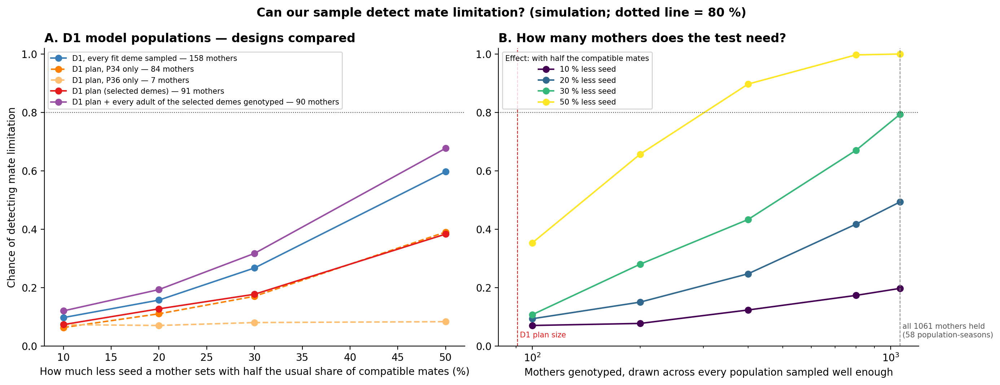
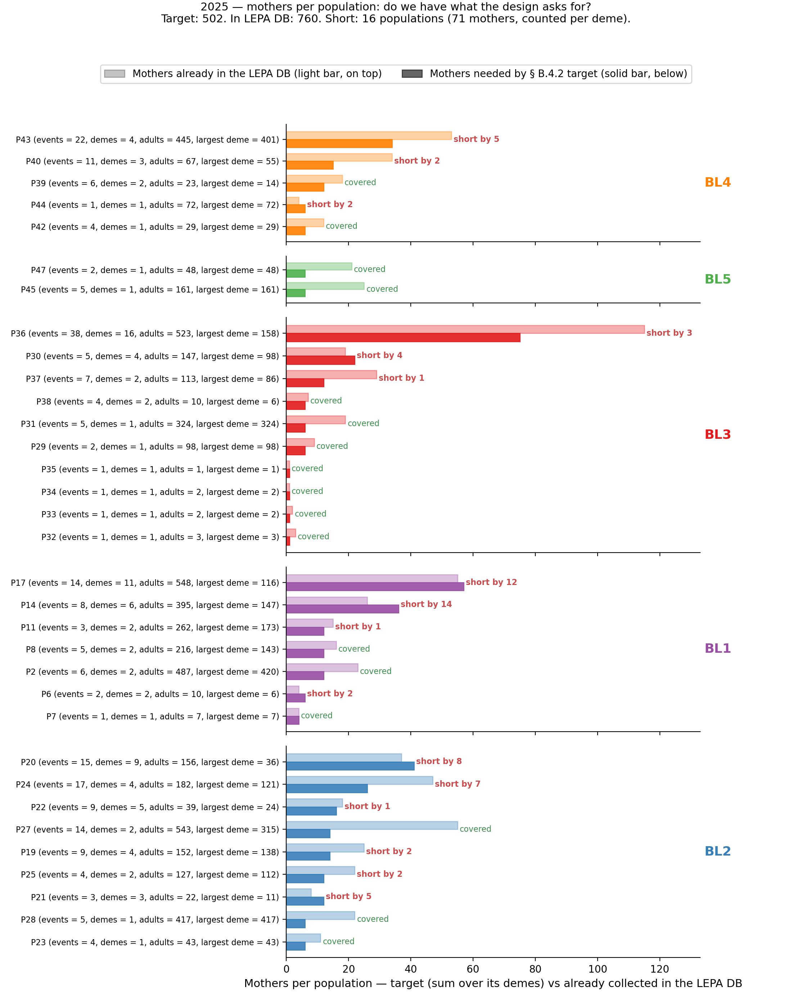
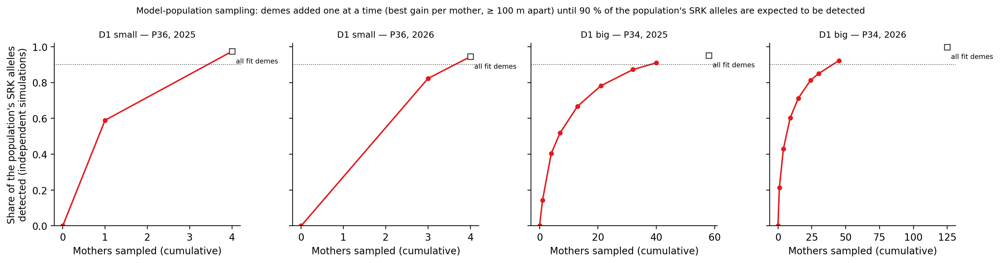

# Sampling design — testing the predictions with seed–mother genotyping

> **Archived 2026-10-24, no longer maintained.** The agreed plan is in [`Sampling_design.md`](../Sampling_design.md).

**Companion to [`Project_outline.md`](../Project_outline.md).** The outline
defines the units (populations, Bottleneck Lineages, 50 m demes), the
predictions (SRK allele diversity and pollen compatibility) and the
seed-yield test. This document covers how we sample mothers and seeds to
test those predictions, and whether the material we already hold is
enough to do so. Run order and file details are in
[`PIPELINE.md`](../PIPELINE.md).

---

## Summary — a two-step plan to recover 90 % of each population's SRK diversity

Testing the predictions needs **seed–mother genotyping**: each seedling
carries 2 paternal SRK alleles drawn from its mother's pollen pool, so the
seedlings of a mother sample the pollen pool of her deme. The goal is to
recover **90 % of the predicted SRK diversity of every population** while
sampling as few plants as possible and keeping a **balanced geographic
representation** of the population.

**Each mother: 25 seeds germinated → ≈ 15 seedlings genotyped** (§ 1).
Seeds germinate at ≈ 60 %; 15 seedlings detect every allele in a mother's
local pollen pool with 90 % probability.

**Step 1 — within each deme: enough mothers to recover 90 % of the deme's
SRK alleles** (§ 2). The number of mothers is scaled to the deme's size
with a plant-by-plant simulation on the same biology as the predictions
— tetraploid plants with the observed SRK zygosity (two thirds carry a
single allele), species-wide allele frequencies, and fathers that must be
compatible with the mother under the Class I / Class II
self-incompatibility system: 2 mothers for a deme of 10 – 20 plants, 5
for 50, 9 for 100, 14 for 200, 23 for 400 and 31 for 1 000, plus **at
least one mother per slick spot**. A deme is **unfit** — and set aside —
if it has a single plant (no mate within 50 m) or if we hold fewer usable
mothers than it needs.

**Step 2 — across the population: spatially separated demes until 90 % of
the population's SRK alleles are recovered** (§ 4). Demes at least
**100 m apart** are added one at a time, the one adding the most expected
new alleles per mother first, until the selection is expected to detect
90 % of the whole population's SRK alleles. The search is repeated from
every possible first deme and the plan with the fewest mothers is kept.
The spacing spreads the sample across the population; the stopping rule
keeps the number of plants to the minimum. The coverage is judged on
independent simulations, so it is not optimistic.

**For the D1 model pair (P36 small + P34 big, BL3), the plan needs
91 mothers over 2025 + 2026 — 2 260 seeds to germinate, ≈ 1 360
seedlings** — instead of 158 mothers for every fit deme. All 91 have
cleaned seed ready. Within each selected deme the mothers are
**drawn at random among those with enough seed (≥ 25)**, not ranked by
seed yield, so the sample represents the population's range of seed set
rather than its most fecund plants. The lab sheet, keyed on
occurrenceID, is
[`step30_D_model_design_lab_sheet.tsv`](../tables/step30_D_model_design_lab_sheet.tsv).

**One adjustment, for P34 in 2025** (§ 4.1). The plan as designed cannot
reach 90 % there: P34's largest 2025 deme (158 plants) holds 9 of the 12
mothers its Step 1 target asks for, so Step 1 sets it aside, and without
it the plan stops at 87 %. That deme is re-admitted with all 9 mothers it
holds, which brings the plan to 90.5 % with 39 mothers. 2026 needed no
adjustment.

**What D1 is for.** D1's first job is SRK diversity: measuring the
alleles a small and a big population of the same lineage actually
hold, deme by deme, to calibrate the drift model, which over-predicts
diversity at the genotyped sites. With 91 mothers D1 is too small to
test mate limitation mother by mother; that test needs hundreds of
mothers across populations (§ 1, Figure S7).

**Can the material we hold test the predictions?** (§ 3) Across all
populations, 27 of 33 (2025) and 32 of 37 (2026) are sampled well enough
to recover 90 % of their SRK alleles with every deme represented; the
others are left out of that season's experiment.

---

## 1. Seedlings per mother

**Question.** How many seedlings must we genotype from each mother to
characterise her local pollen pool well enough to test the
mate-limitation prediction?

**Approach — per-mother allele detection.** Each seedling carries 2
paternal SRK alleles (tetraploid, sporophytic inheritance). Treating pollen
pickup as sampling with replacement from the local pollen pool, the chance
of missing one of K local alleles after 2·n seedling alleles is
`(1 − 1/K)^(2n)`. Setting it to 0.10 gives the seedlings needed for a 90 %
chance to see every allele. **This saturates at 15 seedlings per
mother** — beyond it, each extra seedling adds very little.

**Figure S1.** SRK allele detection under tetraploid inheritance (4 SRK copies per plant; 2 paternal alleles per seedling), with the local pool capped at the species-wide 32 alleles. Shaded bands = 95 % simulation interval. **Panel A — one mother.** x = seedlings genotyped, one curve per slick-spot size class; the **red line at 15** marks the per-mother cap. One mother's 15 seedlings cannot saturate a 32-allele pool in large slick spots — the limit of a single mother, not undersampling. **Panel B — several mothers.** x = mothers sampled (15 seedlings each = 34 allele draws per mother: 4 maternal + 30 paternal). With 5 mothers, every size class reaches its local ceiling. Source: `step14_seed_sampling_per_mother.py`. Data: [`step28_coverage_curves_by_Nfertile.tsv`](../tables/step28_coverage_curves_by_Nfertile.tsv), [`step28_aggregation_curves_by_Nfertile.tsv`](../tables/step28_aggregation_curves_by_Nfertile.tsv).

Figure S1 uses a simplified model (alleles drawn independently, all equally likely in the pollen pool). It supports the cap of 15 seedlings per mother; the number of mothers per deme (§ 2) comes from the full simulation with the observed zygosity and compatible fathers.

**From seeds to seedlings — 60 % germination.** We genotype **seedlings**,
not seeds. LEPA seeds germinate at ≈ 60 % in the greenhouse, so reaching
15 genotyped seedlings per mother means germinating
`ceil(15 ÷ 0.60) = 25` seeds per mother. A seed lot with fewer than 25
seeds is germinated in full and delivers fewer seedlings.

**Can the sample detect mate limitation? (statistical power).**
Recovering SRK alleles is one question; detecting that mothers with
fewer compatible mates set less seed is another. `step23_power_analysis.py`
answers the second by simulation:

1. Every deme is simulated plant by plant at its real size (§ 2), and
   each plant's true compatibility is the share of the other plants of
   its deme it can mate with.
2. Seed yield relative to plant size = an effect of compatibility +
   noise. The effect is stated as *how much less seed a mother sets
   with half the usual share of compatible mates* (10 – 50 %). The noise
   is taken from the seed-yield data (§ 4 of the outline): plants of
   the same size differ about 2.6-fold in seed set (0.41 on the log10
   scale), and whole populations differ further (0.34).
3. Mothers are sampled as the design says; each mother's compatibility
   is estimated from her genotype against the other genotyped plants
   of her deme (or of her population when her deme has fewer than 3).
4. Seed yield is regressed on estimated compatibility within
   populations; power = share of simulations where the link is
   detected (one-sided, 5 %).

| Design | Mothers | Power, 30 % less seed | Power, 50 % less seed |
|---|:-:|:-:|:-:|
| D1 plan | 91 | 18 % | 38 % |
| D1 plan + every adult of the selected demes genotyped | 90 | 32 % | 68 % |
| D1, every fit deme | 158 | 27 % | 60 % |
| Every population sampled well enough (mothers held) | ~1 060 | 79 % | 100 % |
| — random subset | 400 | 43 % | 90 % |
| Comparing population means instead (58 population-seasons) | ~1 060 | 9 % | 13 % |

**What it means.** Mothers differ little in compatibility (typically
0.78, mostly 0.63 – 0.93), so even a strong effect moves seed yield by
about a fifth between typical mothers, against a 2.6-fold spread for
other reasons. **D1 alone cannot test mate limitation mother by
mother** — whatever its design — and **is not meant to: its job is SRK
diversity**, the data needed to calibrate the drift model
(Project_outline § 8). The mother-level test needs hundreds of mothers
across populations (about 400 for a strong effect, about 1 000 for a
moderate one). Genotyping every adult of a deme measures each mother's
compatibility exactly and is the cheapest way to add power where few
mothers are sampled. Comparing population averages is weaker still,
because whole populations differ in seed set for other reasons.

**Figure S7.** Can our sample detect mate limitation? Simulation; dotted line = 80 % power. **A — D1 designs:** chance of detecting the link between compatibility and seed yield against the effect size (how much less seed a mother sets with half the usual share of compatible mates), for the D1 plan, the plan with each population alone, the plan with every adult of the selected demes genotyped, and every fit deme. **B — mothers needed:** the same chance for random subsets of the mothers held across every population sampled well enough, one line per effect size; dashed lines mark the D1 plan's size and all mothers held. Source: `step23_power_analysis.py`. Data: [`step23_power.tsv`](../tables/step23_power.tsv).

---

## 2. Step 1 — mothers per deme

**Question.** How many mothers must we sample in a deme for their
seedlings to reveal the SRK alleles the deme holds?

**Approach** (`srk_detection.py`). Each deme is simulated plant by plant,
on the same biology as the predictions:

1. **The deme.** *N* fertile plants, each tetraploid. How many different
   SRK alleles a plant carries follows what we observe in LEPA (66 % carry
   one allele in all four copies, 32 % two, 2 % three); the alleles are
   drawn from the species-wide frequencies — drift, so rare alleles are
   often absent from a deme.
2. **The mothers.** Only a plant with at least one compatible mate in the
   deme can set seed, so mothers are drawn among those plants.
3. **The seedlings.** Each seedling's father is a random plant compatible
   with its mother under the Class I / Class II self-incompatibility
   system (Class I dominant over Class II; a cross works only if the
   alleles the two parents express differ), and passes on 2 of his 4
   allele copies.
4. **Detection.** A mother's family reveals her own alleles and the
   paternal alleles of her 15 seedlings.

The target is the smallest number of mothers whose families detect, on
average over 1 000 simulated demes, **90 % of the SRK alleles the deme's
plants carry**. On top of that, **at least one mother per slick spot**:
an isolated slick spot's private alleles cannot be recovered from any
other slick spot.

The model was revised twice. The first rule treated all 32 alleles as
equally common. The second used the species-wide frequencies but drew a
plant's 4 copies independently and took fathers from the whole deme,
ignoring the observed homozygosity and self-incompatibility. Because most
plants carry one allele, a deme holds fewer alleles than the second
model assumed (about 15 rather than 21 in a deme of 50), so fewer mothers
are needed:

| Deme size (fertile plants) | 10 | 20 | 50 | 100 | 200 | 420 | 1 000 |
|---|:-:|:-:|:-:|:-:|:-:|:-:|:-:|
| Mothers — observed zygosity + self-incompatibility (current) | 2 | 2 | 5 | 9 | 14 | 23 | 31 |
| Mothers — independent allele copies (2026-10-19 to 10-23) | 2 | 4 | 8 | 13 | 20 | 25 | 23 |
| Mothers — all alleles equally common (first rule) | 6 | 6 | 6 | 6 | 6 | 6 | 6 |

As a check, compatibility between plants in the simulated demes (78 %)
matches the species-wide value used by the predictions.

**Totals across all populations.**

| Season | Populations / demes | Mothers needed | Mothers sampled (in DB) | Seed cleaned | Mothers usable | Short (counted per deme) | Seedlings expected |
|---|:-:|:-:|:-:|:-:|:-:|:-:|:-:|
| 2025 | 33 / 99 | **492** | 765 | 765 | 442 | 50 | 6 579 |
| 2026 | 37 / 189 | **827** | 1 581 | 705 | 803 | 24 | 11 982 |

A mother in one deme cannot stand in for another deme's pollen pool, so
shortfalls are counted deme by deme. 2026 counts every sampled mother; 876
of them still await seed cleaning, and their lots are assumed to deliver
15 seedlings each. Two 2026 demes (P25 deme 2, P4 deme 2) consist only of
slick spots recorded too late to collect seed: they are part of the model
but have no mothers to sample.

**Figure S2.** Do we hold the mothers the design asks for? 2025, one bar pair per population, grouped by Bottleneck Lineage (BL1 → BL5). **Solid bar** = mothers needed (sum over the population's demes); **light bar** = mothers with seed in the LEPA database. "Short by *n*" counts the shortfall deme by deme, so a population can hold more mothers than it needs in total and still be short in one deme (P34, P23). The 2026 version is [`step29c_sampling_per_population_2026.png`](../figures/step29c_sampling_per_population_2026.png). Source: `step17_fragmentation_sampling.py`. Data: [`step29c_sampling_per_population_2025.tsv`](../tables/step29c_sampling_per_population_2025.tsv).

---

## 3. Can our sampling test the predictions?

**Question.** With the mothers we actually hold, will the seedlings
represent each population — or is it undersampled and must be left out of
that season's experiment?

**Approach.** For each population and season, the mothers in each deme are
selected as the design does (at least one per slick spot, then the
best-seeded up to the deme's target), each with the seedlings her seed lot
can deliver (at most 15). The deme simulation of § 2 then predicts:

1. **What the population holds** — the SRK alleles carried by the
   simulated plants of each deme; the population holds an allele if any
   of its demes does.
2. **What our sampling recovers** — in each deme, the selected mothers'
   own alleles plus 2 paternal alleles per seedling from compatible
   fathers; the population's recovered set is the union over demes.
3. **Coverage** = recovered ÷ held, averaged over 1 000 simulated
   populations, with a 95 % interval.

A deme with no mother adds its alleles to what the population holds but
nothing to what we recover — the sampling blind spot. **A population is
undersampled if its seedlings would recover less than 90 % of its SRK
alleles, or if any of its demes has no sampled mother**: the population is
represented only when every deme is sampled. Earlier versions split each
location's mothers across demes by size and counted every seed as
genotyped; both hid the blind spot.

**Result.**

| Season | Sampled well enough | Undersampled (left out) |
|---|:-:|---|
| 2025 | **27 of 33** | P2 (EO30-1), P8 (EO27), P13 (EO27-1) (BL1) · P22 (EO26-4), P26 (EO29) (BL2) · P41 (EO76, BL4) |
| 2026 | **32 of 37** | P4 (EO30-3), P10 (EO27-3), P13 (EO27-1) (BL1) · P25 (EO61), P26 (EO29) (BL2) |

- **Every deme has a sampled mother** in 2025 (99 of 99) and in 2026 except
  the two recorded-only demes (P4 deme 2, 62 plants; P25 deme 2, 20
  plants), where the crew arrived after seed had dropped.
- The other undersampled populations hold mothers in every deme but too
  few in at least one — mostly large populations where a deme target
  exceeds the mothers collected (P13 EO27-1 2025: 35 needed, 21 usable).
  P22 (2025) and P26 (2025) miss the 90 % line narrowly (89.7 % and
  89.9 %). Three mate-limited populations are among them — **P8 (2025),
  P4 and P10 (2026)** — so their genetic test in that season needs more
  mothers.
- All six model-pair populations (D1, D2, D3) and P6 and P42 of the
  genotyped sites are sampled well enough in both seasons; P41 (2025) at
  EO76 is not.
- Counting only seed cleaned so far, 20 populations of 2026 have no usable
  mother yet — the cleaning backlog, not a field gap.

**Figure S3.** Is each population sampled well enough? One row per population, grouped by Bottleneck Lineage; open circle = 2025, filled = 2026; red = undersampled. **Panel A** — predicted share of the population's SRK alleles that its sampled mothers' seedlings would recover (bars = 95 % interval over simulated deme pools; dotted line = 90 %). **Panel B** — share of fertile plants in demes with no sampled mother (any value above 0 = undersampled). **Panel C** — mothers sampled (circle), mothers needed (|) and mothers with cleaned seed so far (×). Source: `step21_sampling_adequacy.py`. Data: [`step30_A_sampling_adequacy_2025.tsv`](../tables/step30_A_sampling_adequacy_2025.tsv), [`_2026`](../tables/step30_A_sampling_adequacy_2026.tsv); per deme: [`step30_A_sampling_adequacy_per_deme_2025.tsv`](../tables/step30_A_sampling_adequacy_per_deme_2025.tsv).

---

## 4. Step 2 — selecting demes across the population (model populations)

Sampling every fit deme to its Step 1 target recovers 96 – 98 % of a
population's SRK alleles, but in a large population it is expensive (P34
needs 54 mothers in 2025 and 97 in 2026). Step 2 reaches the 90 % goal
with far fewer plants while spreading the sample across the population.

**Approach — the plan as designed** (`step28_model_population_design.py`):

1. **Screen the demes.** A deme is unfit if it has a single fertile plant
   or if we hold fewer usable mothers than its Step 1 target (even after
   every sampled seed lot is cleaned).
2. **Select demes.** Each deme keeps its Step 1 target. Demes at least
   **100 m apart** — so selected demes are separate pollen pools and the
   sample covers the population's extent — are added one at a time, the
   one adding the most expected new SRK alleles per mother first, until
   the selection is expected to detect **90 % of the whole population's
   SRK alleles** (unfit demes included in the total).
3. **Try every starting deme.** Adding the cheapest deme first can block,
   through the spacing rule, a deme the population needs later. The
   selection is therefore run once from every fit deme as first pick, and
   the plan that reaches 90 % with the fewest mothers is kept.
4. **Guard against optimism.** Demes are chosen on one set of simulated
   populations; the stopping rule uses 20 independent sets, and the 5th
   percentile is reported. The selection is rerun on 20 fresh sets to
   measure how often each deme is chosen.
5. **Small populations.** When all fit demes together need at most 10
   mothers, all are taken (spacing is moot).
6. **Pick the mothers — at random, not by seed yield.** In each selected
   deme, a mother is **eligible** if her cleaned seed lot holds at least
   25 seeds, enough for the full 15 seedlings. One mother is drawn at
   random from the eligible mothers of every slick spot, and the
   remaining places are drawn at random from the deme's other eligible
   mothers. Lots with fewer than 25 seeds (germinated in full), then
   mothers whose seed is not cleaned yet, are used only when a slick spot
   or deme runs out of eligible mothers. The draw is reproducible (fixed
   random seed per population, year and deme).

### 4.1 The 2025 adjustment for P34

**What happened.** In 2025 the plan as designed cannot reach the goal in
P34. Its largest deme, deme 5 (158 fertile plants, about a third of the
population that year), holds **9 sampled mothers where its Step 1 target
asks for 12**, so step 1 sets it aside. Without it the plan stops at
**87 % with 37 mothers (10 demes)**: the remaining demes that are 100 m
apart do not hold enough of the population's alleles.

**Why it happened.** P34 was not sampled less intensely overall in 2025 —
we hold 22 mothers per 100 fertile plants in 2025 and 21 in 2026 — but
deme 5 was: 9 mothers for 158 plants (6 per 100). It is the only P34
deme short of its target in either season. 2025 seed is collected, so the
gap cannot be closed in the field.

**What we do.** When the plan as designed cannot reach 90 %, a deme set
aside only because it holds too few mothers is re-admitted with **every
mother it holds**, and the selection is rerun. In D1 this applies only to
P34 deme 5 in 2025. The adjusted plan takes 9 demes and **39 mothers and
reaches 90.5 %**. The alternatives were worse: dropping the spacing rule
and taking every other fit deme needs about 45 mothers and still leaves
out the largest deme, and keeping the plan at 87 % weakens P34's 2025
test.

**What it costs.** Deme 5 is sampled with 9 mothers instead of 12, so its
own allele estimate is less precise than the design aims for (the
population as a whole still reaches 90 %). It is marked with * in the
tables and maps.

### 4.2 D1 plan (P36 small + P34 big, BL3)

| Population | Year | Demes (unfit) | Selected demes | Mothers | Seeds → seedlings | SRK alleles detected (5th pct.) |
|---|:-:|:-:|:-:|:-:|:-:|:-:|
| P36 (small) | 2025 | 2 (0) | 2 | 4 | 100 → ~60 | 98.5 % (86 %) |
| | 2026 | 2 (0) | 2 | 3 | 75 → ~45 | 96.3 % (83 %) |
| P34 (big) | 2025 | 16 (2) | 9 (incl. deme 5*) | 39 | 975 → ~585 | 90.5 % (82 %) |
| | 2026 | 21 (1) | 4 | 45 | 1 110 → ~666 | 90.3 % (81 %) |
| **D1** | | | **17 deme-years** | **91** | **2 260 → ~1 356** | |

- **Unfit demes.** P34 2025: two single-plant demes (deme 5 re-admitted,
  § 4.1). P34 2026: one single-plant deme.
- **Selected demes** (deme · mothers, in order of selection). P34 2025:
  2 · 8, 12 · 4, 5 · 9\*, 13 · 3, 8 · 2, 14 · 4, 10 · 1, 4 · 2, 3 · 6.
  P34 2026: 9 · 17, 2 · 9, 3 · 5, 20 · 14. P36: both demes in both years.
- **Representation.** The selected demes hold 76 % (2025) and 54 %
  (2026) of P34's fertile plants. In 2026 the four demes are large and
  spread from the north-west to the south of the population (Figure S6);
  a plan of 15 small demes needed 58 mothers and held only 48 % of the
  plants.
- **Is the selection better than chance?** Adding demes in random order,
  with the same 90 % stopping rule, takes a median of 42 mothers in 2025
  (79 % of random orders need more than the plan's 39) and 57 in 2026
  (98 % need more than 45) — Figure S5 D.
- **Stability.** In 2025, 6 of the 9 selected demes are chosen in every
  rerun, the others in 40 – 95 %. In 2026 several near-equivalent plans
  exist: deme 3 is chosen in every rerun, demes 20, 9 and 2 in 75 %, 65 %
  and 40 %, and demes 1, 14 and 12 come in instead in 35 – 60 %. The
  coverage goal is met either way; the plan is one good choice among a
  few, fixed by its random seed so the lab sheet does not change between
  runs.
- **Why random rather than the best-seeded mothers.** Beyond 25 seeds,
  more seed does not give more seedlings, so seed count has no
  genotyping value — but ranking by it would pick the mothers that set
  the most seed, i.e. those that found compatible mates. That sample
  would overstate SRK diversity at the compatible end, understate mate
  limitation, and weaken the comparison of compatibility with seed set
  that D1 is built for (most of all in the small population). When this
  was checked on the 2026-10-22 plan, the earlier best-seeded rule took
  57 – 75 % of its mothers from the top half of seed yield, the random
  draw 50 – 51 %.
- **Material.** All 91 mothers have cleaned seed ready to germinate. One
  P34 2026 lot holds only 10 seeds, hence 2 260 seeds rather than 91 × 25.
- **Spacing.** P36's two demes are less than 100 m apart, which is why the
  small-population rule keeps both.

**Figure S4.** D1 deme selection. One panel per population and season: the share of the population's SRK alleles expected to be detected (independent simulations) as demes are added in the order of Step 2, against the cumulative number of mothers; dotted line = 90 %; open square = every fit deme sampled. Source: `step28_model_population_design.py`.

**Figure S5.** What the simulations behind the D1 plan show. **A — Step 1:** share of a deme's SRK alleles detected against the number of mothers (15 seedlings each), one curve per deme size; dot = the Step 1 target; dotted line = 90 %. **B — selected demes:** SRK alleles each selected deme holds (grey) and the alleles its mothers' seedlings detect (red), mean and 95 % interval over simulated demes; labels give plants (pl.) and mothers (m.). **C — population coverage:** share of the population's SRK alleles detected over independent simulations, for the plan (red) and for sampling every fit deme (blue); bar = median; dotted line = 90 %. **D — the plan against chance:** mothers needed to reach 90 % when demes are added in random order (grey, 100 orders) against the plan (red line). **E — stability:** share of 20 reruns on fresh simulations in which each fit deme is selected; red = in the plan. Source: `step28_model_population_design.py`.

**Figure S6.** Demes of P34 (top) and P36 (bottom) per season. Positions are in metres from an arbitrary origin, with no background and no geographic coordinates; north is up. Each deme is drawn as the outline of its slick spots (black dots, sized by fertile plants) buffered by 25 m. Coloured = selected (label: deme · mothers; * = fewer mothers held than its target, all used, § 4.1); grey = fit but not selected; dashed = unfit. Source: `step28_model_population_design.py`. Maps of the same demes on the elevation background with latitude and longitude (`figures/step30_D_model_design_demes_P34`, `_P36`) are kept off the public repository; `./run_pipeline.sh design` writes them locally.

**Caveat.** The model treats demes as independent samples from the
species-wide SRK frequencies. Real demes have drifted further
(Project_outline § 5: 5 – 9 alleles observed where 22 – 29 were
predicted at five of six sites) and neighbouring demes share alleles, so actual recovery will
differ, and the spacing between selected demes matters more in reality
than in the model. D2 and D3 can be planned the same way
(`step28_model_population_design.py --pairs D2,D3`).

---

## 5. The locked recipe and the files to use

| Quantity | Value |
|---|---|
| Pollinator radius / drift unit | **50 m deme** (connected component of slick spots within 50 m) |
| Seeds to germinate per mother | **25** (= ceil(15 ÷ 0.60)) |
| Seedlings genotyped per mother | **15** |
| Step 1 — mothers per deme | Size-scaled: 90 % of the deme's SRK alleles detected (observed zygosity, compatible fathers), + ≥ 1 per slick spot |
| Unfit deme | Single plant, or fewer usable mothers held than its target — re-admitted with all its mothers only if the plan cannot reach 90 % without it (§ 4.1) |
| Step 2 — deme selection | Demes ≥ 100 m apart, best gain per mother, from every possible first deme; the plan reaching 90 % of the population's SRK alleles with the fewest mothers |
| Mothers within a selected deme | Random among cleaned lots with ≥ 25 seeds: one per slick spot, then the rest of the target; smaller lots, then uncleaned lots, only as fallback |
| Undersampled population | Left out for that season (< 90 % recovered, or a deme with no mother) |

**Files.**

- **Lab sheet for the model populations, keyed on occurrenceID** (germplasmIDs
  are still missing for the seed lots not cleaned yet):
  [`step30_D_model_design_lab_sheet.tsv`](../tables/step30_D_model_design_lab_sheet.tsv)
  — one row per mother: occurrenceID, germplasmID, BL, population, EO,
  location, year, deme, slick spot, status ("germinate" / "clean seed
  first"), seeds held, seeds to germinate, expected seedlings and why the
  mother was selected.
- **Lab list for the model populations — the germplasmIDs to pull, deme by
  deme:**
  [`step30_D_model_design_germplasm_by_deme.csv`](../tables/step30_D_model_design_germplasm_by_deme.csv)
  (one row per mother: germplasmID, occurrenceID, ready or "clean seed
  first", seeds held, seeds to germinate, expected seedlings, reason for
  selection). Deme screening and selection:
  [`step30_D_model_design_demes.tsv`](../tables/step30_D_model_design_demes.tsv);
  totals: [`step30_D_model_design_summary.tsv`](../tables/step30_D_model_design_summary.tsv).
- **All-population lab recipe (Step 1 targets, every deme):**
  [`step29c_partC_germplasmID_selection_2025.tsv`](../tables/step29c_partC_germplasmID_selection_2025.tsv),
  [`_2026`](../tables/step29c_partC_germplasmID_selection_2026.tsv).
- **Field-team recipe for a new season** (mothers per slick spot):
  [`step29c_sampling_frag_aware_per_event_2025.tsv`](../tables/step29c_sampling_frag_aware_per_event_2025.tsv).
- **Sampling check per population:**
  [`step30_A_sampling_adequacy_2025.tsv`](../tables/step30_A_sampling_adequacy_2025.tsv),
  [`_2026`](../tables/step30_A_sampling_adequacy_2026.tsv).
- **Which slick spots share a pollen pool:**
  [`step29a_event_to_deme.tsv`](../tables/step29a_event_to_deme.tsv).

**Sensitivity to the pollinator radius.** The 50 m deme is chosen on
pollinator biology. At 50 m the Step 1 design needs 492 mothers in 2025
(827 in 2026), 19 % (27 %) fewer than at 10 m; beyond 75 m it changes
little, and if the true radius were only 25 m the design would be 11 %
(20 %) short (Project_outline Figure 1).
